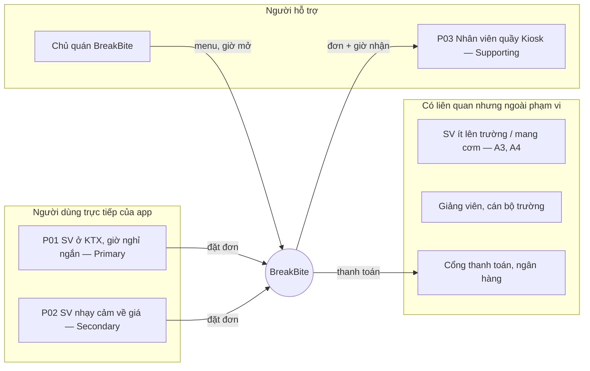

# UX Research: Khảo sát, phỏng vấn mô phỏng và tổng hợp

> **Tài liệu:** `02-P1-nghien-cuu/02-research.md` — bước đứng trước `03-P2-ux-design/01-persona.md`.
> **Quy trình:** Khảo sát thị trường → Phỏng vấn sinh viên giả lập bằng AI → Tổng hợp (affinity map) → Persona → Yêu cầu thiết kế → `04-P3-ui-concept/01-DESIGN.md` → prompt Stitch.
> **Quy tắc:** chỉ ghi điều đã làm hoặc tìm được, kèm nguồn. Phần chưa làm được ghi rõ là "chưa thực hiện" ở mục 5.

---

> Đầu mối P1 (research plan, protocol, evidence log, insight, journey, Gate G1): [`02-P1-nghien-cuu/01-p1-research.md`](01-p1-research.md).
> Phase trước (P0: Idea Board, problem statement, assumption log, MVP scope): [`01-P0-y-tuong/01-p0-problem-framing.md`](../01-P0-y-tuong/01-p0-problem-framing.md).

## 1. Phương pháp — khảo sát Google Form

- Bộ 22 câu cho RQ1–RQ5, rẽ nhánh, ngưỡng đọc kết quả H1–H5: `02-P1-nghien-cuu/khao-sat/khao-sat-cau-hoi.md`.
- Form tạo bằng `02-P1-nghien-cuu/khao-sat/tao-google-form.gs`; sheet phân tích: `02-P1-nghien-cuu/khao-sat/ket-qua-khao-sat-MO-PHONG.xlsx`.
- Đã chạy thử bằng 20 phản hồi mô phỏng (SIM-S01…S20, nhãn Assumed); đang thu phản hồi thật.

## 2. Phỏng vấn

### 2.1 Danh sách

| Mã | Loại | Mô tả ngắn | Ngày | Ghi chú |
|---|---|---|---|---|
| A1 Quân | AI giả lập (Claude Opus 5.5) | Năm 2 KTPM, ở KTX, nghỉ 15 phút, Android | 17/10/2026 | Nhóm mục tiêu |
| A2 Linh | AI giả lập | Năm 1 Thiết kế, ở trọ, nhạy cảm về giá, iPhone cũ | 17/10/2026 | Nhóm phụ |
| A3 Tuấn | AI giả lập | Năm 4, ít lên trường, không thích cài app | 17/10/2026 | Ngoài nhóm mục tiêu |
| A4 Hà | AI giả lập | Năm 3, mang cơm từ nhà, trả tiền mặt | 17/10/2026 | Ngoài nhóm mục tiêu |
| A5 Khang | AI giả lập | Năm 2 ATTT, KTX, trợ giảng lab, giờ nghỉ thất thường | 17/10/2026 | Nhóm mục tiêu |

Toàn văn: [`02-P1-nghien-cuu/04-ai-persona-interviews.md`](04-ai-persona-interviews.md). Người thật: **chưa phỏng vấn** (xem mục 5).

---

## 3. Tổng hợp (Affinity map)

| Nhóm ý | Ý cụ thể | Số nhân vật nhắc (x/5) | Ai nói | Kết luận |
|---|---|---|---|---|
| Thời gian | Hàng chờ đúng giờ nghỉ → bỏ bữa hoặc trễ lớp | 3/5 | A1, A2, A5 | Pain point chính |
| Thời gian | Muốn biết trước bao lâu xong, quán mở hay đóng, còn món không | 4/5 | A1, A3, A4, A5 | Hiển thị thời gian chờ và trạng thái quán |
| Thời gian | Muốn hẹn giờ lấy | 1/5 | A5 | Đưa vào, nhưng là tính năng phụ |
| Thao tác | Cầm máy một tay, ghét nút ở trên cao | 2/5 | A1, A5 | CTA ở nửa dưới, vùng chạm 48 dp |
| Giao hàng | App giao hàng không vào được khu lớp học hoặc lab | 2/5 | A1, A5 | Chứng minh ngách "nhận tại quầy" |
| Giá | Ngại phí ẩn, muốn thấy tổng tiền sớm | 2/5 | A1, A2 | Giá động trên nút CTA, không có phí giao |
| Rào cản | Không muốn đăng ký hay đăng nhập trước | 2/5 | A1, A3 | Xem menu không cần tài khoản |
| Rào cản | Không muốn cài thêm app | 1/5 | A3 | Rủi ro; hướng web đặt qua QR là phương án dự phòng |
| Thanh toán | Lỗi thanh toán từng làm mất giỏ hàng | 1/5 | A5 | Màn phục hồi lỗi, giữ giỏ hàng |
| Thanh toán | Muốn trả tiền mặt khi lấy | 2/5 | A2, A4 | Tiền mặt tại quầy là một lựa chọn |
| Mạng | Mạng trong campus chập chờn | 1/5 | A1 | Có trạng thái loading và lỗi rõ ràng |

**Mâu thuẫn:** A3 và A4 không cần app vì ít ăn ở trường. A4 muốn trả tiền mặt, trong khi A1 và A5 ưu tiên QR hoặc ví. → Nhóm mục tiêu là sinh viên ở KTX có giờ nghỉ ngắn; giữ nhiều phương thức thanh toán.

---

## 4. Từ insight đến yêu cầu thiết kế (truy vết)

| Insight (mục 3) | Nguồn | → Persona | → Yêu cầu thiết kế | → Trong sản phẩm |
|---|---|---|---|---|
| Hàng chờ giờ nghỉ làm bỏ bữa | A1, A2, A5 | Bối cảnh 15 phút, pain point 1 | Đặt trước, có món khi tới quầy | Flow 1 · SCR-05 chọn giờ nhận |
| Cần biết thời gian chờ và quán mở/đóng | A1, A3, A4, A5 | Mục tiêu 2 | Badge trạng thái Kiosk + thời gian ước tính | SCR-02 · quyết định 01 |
| Cầm máy một tay | A1, A5 | Thói quen thiết bị | Vùng chạm 48 dp, CTA ở nửa dưới | `DESIGN.md` mục 3 · prompt Stitch · quyết định 13 |
| Ngại phí ẩn | A1, A2 | Pain point 4 | Giá cộng dồn trên nút, hiện tổng sớm | SCR-04 · quyết định 02 |
| Không muốn đăng ký | A1, A3 | Pain point 4 | Không bắt đăng nhập để xem menu | Quyết định 12 (từ chối thêm đăng nhập) |
| Thanh toán lỗi làm mất giỏ | A5 | Kết nối chập chờn | Màn phục hồi, tiền mặt dự phòng, giữ giỏ hàng | SCR-06-ERR · Flow 3 |

---

## 5. Bản đồ người dùng và mức bao phủ persona

### 5.1 Stakeholder / User Map

**Nhóm dễ bị bỏ sót:** sinh viên không có tài khoản ngân hàng (cần tiền mặt), sinh viên khiếm thị dùng trình đọc màn hình (cần nhãn cho icon), giảng viên muốn mua nhanh giữa hai tiết. Chưa thiết kế riêng cho các nhóm này; ghi lại trong backlog.

### 5.2 Persona Coverage Matrix

| Nhu cầu / tình huống | P01 | P02 | P03 | Màn hình |
|---|:---:|:---:|:---:|---|
| Đặt nhanh trong giờ nghỉ | ● | ○ | | SCR-02 → SCR-07 |
| Biết quán mở/đóng, thời gian chờ | ● | ○ | ● | SCR-02 |
| Thấy tổng tiền sớm, không phí ẩn | ○ | ● | | SCR-04, SCR-05 |
| Mã giảm giá | | ● | | SCR-05 |
| Phục hồi khi thanh toán lỗi | ● | ○ | ○ | SCR-06-ERR |
| Mã nhận đồ dễ đối chiếu | ● | | ● | SCR-07 |
| Đặt lại đơn cũ | ○ | ○ | | SCR-08 |

● nhu cầu chính · ○ nhu cầu phụ

## 6. Assumption & Research Backlog

| ID | Giả định | Nhãn hiện tại | Ảnh hưởng nếu sai | Cách kiểm chứng | Ưu tiên |
|---|---|---|---|---|---|
| H1 | Giờ nghỉ giữa slot ≤ 15 phút | Assumed (A1, A5) | Giảm giá trị của "đặt trước" | Khảo sát Google Form (Q5) | Cao |
| H2 | Hàng chờ giờ nghỉ làm SV bỏ mua | Assumed (A1, A2, A5) | Mất lý do tồn tại của app | Bấm giờ hàng chờ 2 khung giờ | Cao |
| H3 | Biết trước thời gian chờ và trạng thái quán quyết định việc đặt | Assumed (4/5) | Badge Kiosk ít giá trị | Hỏi "bạn cần biết gì trước khi đặt?" | Vừa |
| H4 | SV chấp nhận cài app riêng của quán | Assumed — A3 phản đối | Ít người cài | Hỏi trực tiếp; dự phòng hướng web đặt qua QR | Cao |
| H5 | Khi thanh toán lỗi, SV muốn chuyển tiền mặt | Assumed (A5, A2, A4) | Flow 3 chọn sai lối thoát | Hỏi lần lỗi gần nhất | Vừa |
| H7 | Bếp làm kịp nhiều đơn đặt trước dồn vào cùng giờ nghỉ | Assumed (phản biện P0-C04) | Món chưa xong khi SV tới, mất niềm tin | Hỏi chủ quán | Cao |
| H8 | Khách chọn trả tiền mặt vẫn tới lấy món đúng giờ | Assumed (phản biện P2-C05) | Bếp nấu mà không ai lấy, quán lỗ | Hỏi chủ quán tỉ lệ bỏ đơn hiện tại | Vừa |
| H6 | Nhân viên quầy cần mã lớn + QR để trả món nhanh | Assumed | Mã nhận đồ không giúp được quầy | Hỏi 1 nhân viên quầy | Vừa |

## 7. Kế hoạch kiểm chứng (Milestone B)

1. Khảo sát Google Form **≥ 30 sinh viên** (bộ câu hỏi `02-P1-nghien-cuu/khao-sat/khao-sat-cau-hoi.md`), tách nhóm P01 / P02 theo câu Q2 (nơi ở). Ẩn danh; đổi nhãn Assumed → Reported cho các ý đạt ngưỡng.
2. Bấm giờ hàng chờ ở căn tin trong 2 khung giờ nghỉ (Observed).
3. Hỏi 1 nhân viên quầy về cách trả món (P03).
4. Usability test: 3–5 người chạy Flow 1 trên prototype, đo thời gian và số chạm so với tiêu chí "dưới 35 giây, 8 chạm".
5. Cập nhật persona, file Excel `03-P2-ux-design/02-persona-mapping.xlsx` và bảng quyết định theo kết quả.

## 8. Hạn chế và việc chưa làm

- **Chưa phỏng vấn người thật và chưa đo hàng chờ thực tế.** Toàn bộ insight ở mục 3 đến từ 5 nhân vật giả lập do AI tạo. Theo [tổng hợp so sánh của NN/g](https://radar.zurb.com/article/nielsen-norman-synthetic-users-were-too-shallow-to-be-useful-against-three-real-studies), người dùng giả lập thường nông và dễ đồng thuận hơn người thật. Vì vậy persona là **proto-persona**: dùng tốt để định hướng thiết kế, nhưng các con số chưa được kiểm chứng.
- **Bước tiếp theo nếu có thêm thời gian:** hỏi 3–5 sinh viên thật bằng 5 câu giả thuyết ở `02-P1-nghien-cuu/04-ai-persona-interviews.md` mục B3; bấm giờ hàng chờ ở căn tin trong 2 khung giờ nghỉ; cho 3 bạn chạy Flow 1 trên prototype để đo chỉ số "dưới 35 giây, 8 chạm".
