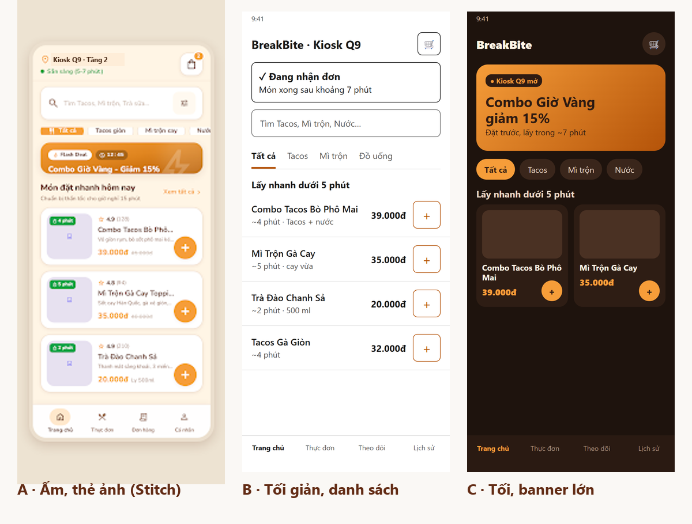
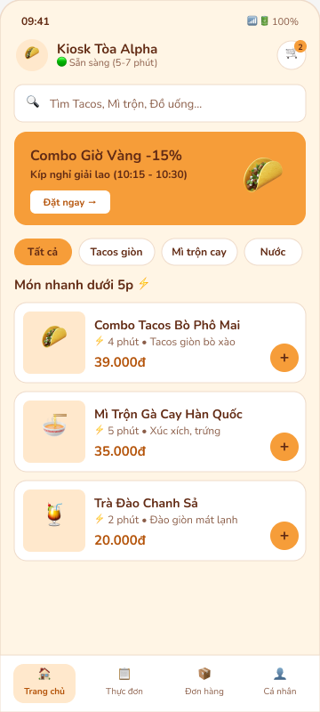
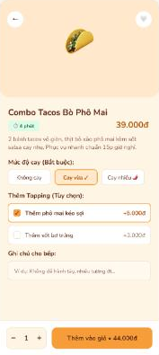
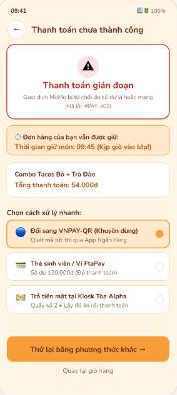

# P3 · UI Concept & App Style Guide

> BreakBite · PRM323 Lab 2 · Gate G3 · Ngày lập: 20/10/2026
> Token chi tiết: `04-P3-ui-concept/01-DESIGN.md` · Prompt, vòng lặp, critique: `08-ai-log/01-ai-design-log.md`

## 1. Concept Exploration — 3 hướng trên màn S02 Trang chủ

| | A · Ấm, thẻ ảnh | B · Tối giản, danh sách | C · Tối, banner lớn |
|---|---|---|---|
| Nguồn | Google Stitch | Claude (HTML) | Claude (HTML) |
| Ý tưởng | Màu thương hiệu BreakBite, thẻ món có ảnh, banner ưu đãi | Nền trắng, 1 màu nhấn, danh sách chữ, khối trạng thái quán | Nền nâu đen, banner cam lớn, lưới 2 cột |
| Thấy được (không cuộn) | ~2,5 món | 4 món | 2 món |
| Tương phản chữ chính | 10,37:1 | 17,4:1 | 16,85:1 |

**So sánh theo persona** (1–5):

| Tiêu chí | A | B | C | Căn cứ |
|---|:---:|:---:|:---:|---|
| Đọc ngoài nắng | 4 | 5 | 2 | Màn tối bị loá ngoài trời |
| Quét nhanh, thấy nhiều món | 3 | 5 | 2 | Persona có 15 phút |
| Chọn món bằng ảnh | 5 | 1 | 4 | P01 chọn bằng mắt khi vội |
| Thấy trạng thái quán trước | 3 | 5 | 3 | US03 |
| Nhận diện thương hiệu | 5 | 2 | 3 | Bảng màu thương hiệu BreakBite (cam, nâu, kem) |
| Ràng buộc đề (light theme) | 5 | 5 | 1 | Đề bắt buộc light theme |
| **Tổng** | **25** | 23 | 15 | |

**Chọn A, mượn 2 điểm của B (D33):**
- Đặt trạng thái quán thành khối riêng ở đầu Trang chủ.
- Thu nhỏ banner để thấy ≥ 3 món mà không cần cuộn.

**Loại C (D34):** đọc kém ngoài nắng, banner chiếm chỗ của món, và đề bắt buộc light theme.

## 2. Key screens

| Màn | Bản Stitch ban đầu | Bản Figma hiện tại | Áp quyết định |
|---|---|---|---|
| S02 Trang chủ | `assets/stitch/01_initial_stitch_home.png` | `assets/figma/final-ui/S02.png` | D33 (một phần), D06, D38 |
| S04 Chi tiết món | `assets/stitch/02_initial_stitch_detail.png` | `assets/figma/final-ui/S04.png` | D06; D13 chưa áp |
| S06-ERR Lỗi thanh toán | `assets/stitch/iteration3_after_error_handling.png` | `assets/figma/final-ui/S06-ERR.png` | D11, D16; D39 chưa áp |

| S02 | S04 | S06-ERR |
|:---:|:---:|:---:|
|  |  |  |

Bảng token và component trong Figma: `assets/figma/design-system/design-system.png` (Page 04), `assets/figma/design-system/components.png` (Page 05).

### 2.1 Đối chiếu với Figma (sửa qua Figma MCP ngày 20/10/2026)

| Hạng mục | Style guide | Figma sau khi sửa | Trạng thái |
|---|---|---|:---:|
| Chữ trên nút cam | `#622B14` (5,23:1) | Đã đổi ở mọi nút (trước: trắng 2,14:1) | ✅ |
| Chữ nhấn trên nền kem | `#B45309` (4,65:1) | Giá, link đã đổi (trước: cam ~2:1) | ✅ |
| Chữ phụ | `#8A5D48` | Đã đổi (trước: `#966A55` 4,33:1) | ✅ |
| Success / Error | `#15803D` / `#B91C1C` | Đã đổi | ✅ |
| on-primary, primary-text, border-input | Có token | Đã thêm | ✅ |
| Token là Variables | `color/`, `spacing/`, `radius/` | Collection `BreakBite Design Tokens`; màu trên màn đã gắn biến | ✅ |
| Component đặt tên dùng lại | `Button/Primary`, `State=…` | 5 Component Set có Variant ở Page 05 | ✅ |
| Màn dùng instance của component | — | Màn vẫn là vector phẳng | ❌ |
| Chữ nội dung ≥ 14 sp | ≥ 14 sp | ~150 text cỡ 9–13 sp | ❌ |
| S02 theo D33 | Khối trạng thái quán + ≥ 3 món | Header có trạng thái quán; banner vẫn lớn | ⚠️ |
| Màn 412 dp | S02, S04, S05 | Chưa có | ❌ |

## 3. App Style Guide

### 3.1 Color roles

| Vai trò | Token | Giá trị | Dùng cho |
|---|---|---|---|
| Nhấn chính | `color-primary` | `#F69D39` | Nền nút chính, tab đang chọn — **không** dùng làm màu chữ |
| Chữ trên nhấn | `color-on-primary` | `#622B14` | Chữ, icon trên nút cam |
| Chữ nhấn | `color-primary-text` | `#B45309` | Giá, link, nút outline |
| Nền / bề mặt | `color-background` · `color-surface` | `#FFF5E5` · `#FFFFFF` | Nền màn · thẻ, dialog |
| Chữ | `color-text-primary` · `color-text-secondary` | `#622B14` · `#8A5D48` | Nội dung · nhãn phụ |
| Viền điều khiển | `color-border-input` | `#8A7A70` | Ô nhập, checkbox |
| Trạng thái | `color-success` · `color-error` | `#15803D` · `#B91C1C` | Luôn kèm icon + chữ |

### 3.2 Type scale (Nunito)

| Token | Cỡ | Dùng cho |
|---|---|---|
| display-large | 24 sp Bold | Mã nhận đồ, tổng tiền |
| headline | 20 sp Bold | Tiêu đề màn |
| title-medium | 16 sp SemiBold | Tên món, tiêu đề dialog |
| body-large / body-medium | 15 / 14 sp | Nội dung (tối thiểu 14 sp) |
| label-large | 14 sp Bold | Chữ trên nút |
| label-small | 12 sp | **Chỉ** nhãn tab có icon (D36) |

### 3.3 Spacing và grid

- **Lưới 4 dp:** 4 · 8 · 12 · 16 · 24 · 32 · 48.
- **360 dp:** 4 cột, lề 16 dp, khoảng cách cột 8 dp.
- **412 dp:** lề giữ 16 dp, nội dung giãn ngang (Fill container).
- **≥ 600 dp:** 8 cột, NavigationRail, lưới món 2–3 cột.

### 3.4 Density

| Quy tắc | Giá trị |
|---|---|
| Thẻ món danh sách / có ảnh | ≥ 72 dp / 104–120 dp |
| Món thấy được ở S02 không cần cuộn | ≥ 3 |
| Khoảng cách giữa khối / trong khối | 24 dp / 8–12 dp |
| Hành động chính mỗi màn | 1 |

### 3.5 Component states

| Component | States |
|---|---|
| Button primary | default · pressed `#F8A94F` · disabled · loading |
| Text field | default · focused · filled · error · disabled |
| Card món | default · pressed · Tạm hết (D30) |
| Chip | default · selected |
| Navigation bar | 4 đích × selected |
| App bar | default · có action |
| Dialog | xác nhận · destructive |
| Status badge | Đang nhận đơn · Tạm dừng · Đã thanh toán · Trả tại quầy |
| Loading / Empty / Error | skeleton, spinner · icon + câu + 1 hành động · nguyên nhân + Thử lại |

**Ảnh món (D37):** tỉ lệ 1:1, nền `#FFF5E5`; khi tải lỗi thì hiện tên món.

### 3.6 Naming

- **Token:** `color-primary-pressed`, `type-body-medium`, `spacing-md`; trong Figma Variables chia nhóm `color/`, `spacing/`, `radius/`.
- **Component:** `Button/Primary` (`State=Loading`), `Card/Food` (`State=OutOfStock`).
- **Frame:** `S02 · Trang chủ`, `S06-ERR · Lỗi thanh toán`.

## 4. Accessibility baseline

| Cặp màu | Tỉ lệ | Ngưỡng |
|---|---|---|
| Chữ chính / nền | 10,37:1 | 4,5:1 ✅ |
| Chữ nút / cam (trước đây chữ trắng 2,14:1) | 5,23:1 | 4,5:1 ✅ |
| Chữ nút / pressed | 5,75:1 | 4,5:1 ✅ |
| Chữ phụ / trắng | 5,62:1 | 4,5:1 ✅ |
| Chữ nhấn / nền | 4,65:1 | 4,5:1 ✅ |
| Lỗi / nền | 5,99:1 | 4,5:1 ✅ |
| Viền ô nhập | 3,93:1 | 3:1 ✅ |

Figma đã áp các cặp màu trên (mục 2.1). Còn lại: nút −/+ ở S04, S05 khoảng 24 dp (cần 48 dp) và khoảng 150 text dưới 14 sp.

## 5. AI phản biện và quyết định

Claude Opus 5.5, 20/10/2026. Nguyên văn: `08-ai-log/01-ai-design-log.md` Phụ lục F.

| Phát hiện | Quyết định |
|---|---|
| Concept A che bớt món vì banner lớn | **D33 Modify:** chọn A, mượn khối trạng thái + banner nhỏ của B |
| Concept C nền tối | **D34 Reject:** kém ngoài nắng; đề bắt buộc light theme |
| So sánh concept thiếu công bằng (A là Stitch, B và C là mockup) | **D35 Accept:** ghi rõ nguồn; B, C dùng cùng nội dung và khung 360 × 800 |
| Còn chữ 12 sp trong thang chữ | **D36 Modify:** chỉ dùng cho nhãn tab có icon |
| Chưa quy định ảnh món | **D37 Accept:** ảnh 1:1, fallback tên món |

## 6. Gate G3

| Điều kiện | Kết quả |
|---|:---:|
| **[C]** ≥ 2 visual direction, chọn có lý do theo persona/task | ✅ |
| **[C]** Style guide có color roles, type scale, spacing, grid, density, component states | ✅ |
| **[C]** Tương phản 4,5:1 / 3:1; vùng chạm ≥ 48 dp; chữ ≥ 14 sp | ⚠️ Tương phản đạt trong Figma; còn nút −/+ ~24 dp và chữ < 14 sp |
| Key screens có thứ bậc rõ, màu nhấn có vai trò | ⚠️ Cần dựng lại S02 theo D33 |
| Token, component đặt tên dùng lại được | ✅ Variables + 5 Component Set có Variant |
| Đã kiểm concept trên thiết bị chủ đạo và nội dung dài | ❌ |

**Chưa qua.** Việc còn lại ở `00-quy-trinh/05-TIEN-DO.md`: nút −/+ 48 dp, chữ ≥ 14 sp, thu nhỏ banner S02, màn 412 dp.
