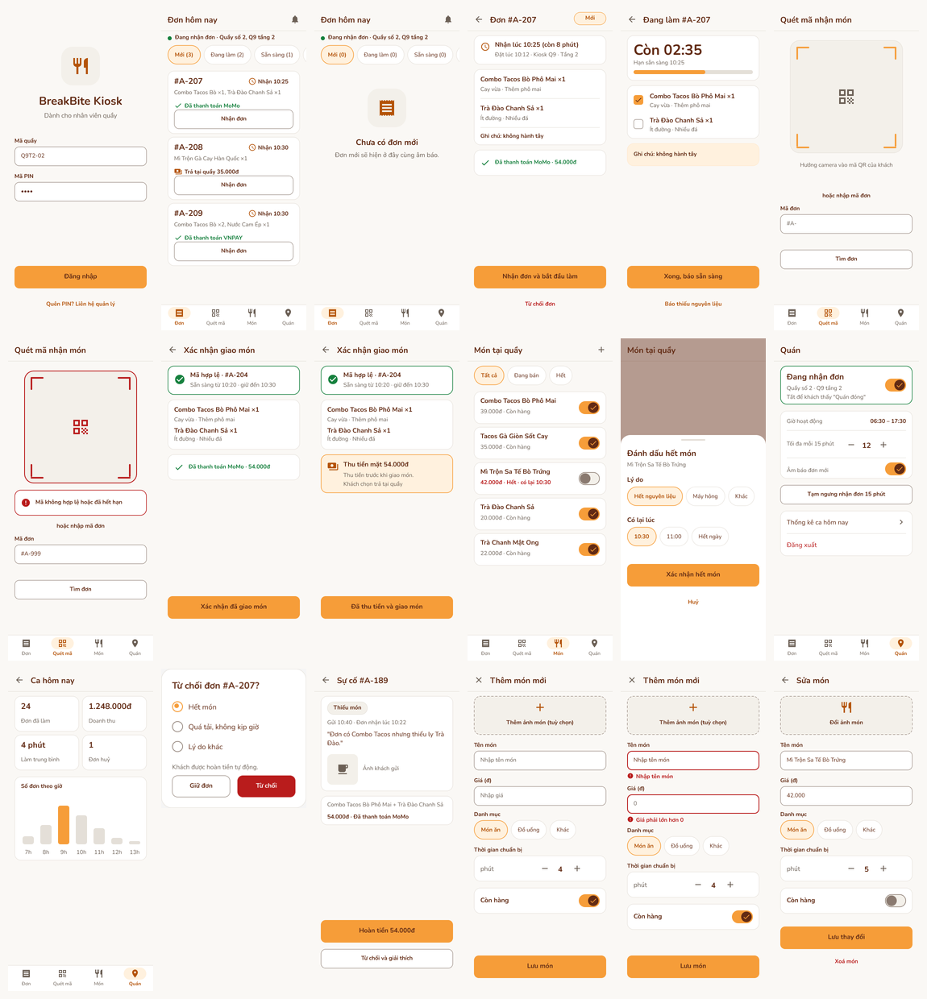

# App người bán (BreakBite Kiosk)

> Figma [PRM323](https://www.figma.com/design/5vloc9G7UcEI9NYJGpTqN0/PRM323--Copy-?node-id=1-260), Page 03, phần "APP NGƯỜI BÁN" (y ≥ 11000), khung có hậu tố " v2" và bản 412 dp " v2 · 412"
> Ảnh: `assets/figma/final-ui-v2/kitchen/` · Tổng quan: `assets/figma/final-ui-v2/contact-sheet-kitchen.png`

App cho nhân viên quầy nhận đơn, làm món, quét mã giao món, báo hết món và xem ca. Cùng hệ thiết kế v2 với app khách (nền `#FAF8F5`, một nút chính màu cam mỗi màn, icon vector, vùng bấm ≥ 48 dp).

## 1. Vì sao cần

Đơn của khách (S05–S07) chỉ có nghĩa khi quầy nhận, làm và giao được. Các màn khách đã hứa: S07 hiện bước "Đã nhận, Đang làm, Sẵn sàng, Hoàn tất"; S20 đưa mã QR cho nhân viên; S22 báo món hết; S24 báo sự cố. Mỗi trạng thái đó cần một màn ở phía quầy đổi nó.

| Màn khách | Thao tác tương ứng của người bán |
|---|---|
| S07 bước "Đã nhận" | K02 → K03: Nhận đơn |
| S07 bước "Đang làm" | K04: Đang chuẩn bị |
| S07 bước "Sẵn sàng", S19 thông báo | K04: Xong, báo sẵn sàng |
| S20 mã QR | K05 quét mã → K06 xác nhận giao món |
| S07-CASH "Trả tại quầy" | K06-CASH: thu tiền mặt rồi giao |
| S03, S22 "Tạm hết" | K08 → K09: đánh dấu hết món |
| S02, S03 danh sách món | K08 → K14: thêm món mới; K15: sửa hoặc xoá món |
| S21 "Quán đóng" | K10: bật/tắt nhận đơn |
| S07-DIALOG huỷ đơn | K03 → K12: từ chối đơn |
| S24 báo sự cố | K13: hoàn tiền hoặc từ chối |

## 2. Điều hướng

Thanh dưới 4 tab: **Đơn** (K02), **Quét mã** (K05), **Món** (K08), **Quán** (K10).

## 3. Flow

| Flow | Input | Output | Đường đi |
|---|---|---|---|
| **K · Nhận đơn, làm món, giao món** | Đơn mới của khách | Đơn hoàn tất, khách nhận đúng món | K01 → K02-EMPTY → (có đơn) K02 → K03 → K04 → K02; K05 → K06 / K06-CASH → K02 |
| **Từ chối đơn** | Hết món hoặc quá tải | Khách được hoàn tiền tự động | K03 → K12 → K02 |
| **Mã sai** | Khách đưa mã hết hạn | Nhập tay mã đơn để tra | K05 → K05-ERR → K06-CASH |
| **Quản lý món** | Một món hết nguyên liệu | Món hiện "Tạm hết" bên khách | K08 → K09 → K08 |
| **Thêm, sửa, xoá món** | Có món mới hoặc đổi giá | Món hiện trong thực đơn khách | K08 → K14 → (thiếu thông tin) K14-ERR → K08; K08 → K15 → K08 |
| **Quản lý quán** | Cần tạm ngưng hoặc xem ca | Quán đóng/mở, thống kê ca | K10 → K11; K10 → K01 (đăng xuất) |
| **Sự cố** | Khách báo thiếu món | Hoàn tiền hoặc từ chối kèm lý do | K02 chuông → K13 → K02 |

## 4. Danh sách màn

| Mã | Màn | Nội dung chính | Trạng thái |
|---|---|---|---|
| K01 | Đăng nhập nhân viên | Mã quầy, PIN | Mặc định |
| K02 | Danh sách đơn | Bốn tab trạng thái kèm số đơn, thẻ đơn với giờ nhận, thanh toán, nút Nhận đơn | Có đơn |
| K02-EMPTY | Chưa có đơn mới | Illustration, tự chuyển sang K02 khi có đơn | Trống |
| K03 | Chi tiết đơn | Giờ nhận, món kèm tuỳ chọn, ghi chú, thanh toán; Nhận đơn, Từ chối | Mới |
| K04 | Đang chuẩn bị | Đếm ngược tới giờ nhận, checklist món, Xong báo sẵn sàng, Báo thiếu nguyên liệu | Đang làm |
| K05 | Quét mã nhận món | Khung ngắm, nhập tay mã đơn | Chờ quét |
| K05-ERR | Mã không hợp lệ | Khung ngắm viền lỗi, thông báo, nhập tay | Lỗi |
| K06 | Xác nhận giao món | Mã hợp lệ, món, đã thanh toán; Xác nhận đã giao | Đã thanh toán |
| K06-CASH | Giao món thu tiền mặt | Nhắc thu 54.000đ trước khi giao | Trả tại quầy |
| K08 | Quản lý món | Chip lọc, hàng món kèm công tắc còn hàng, nút thêm món | Có món hết |
| K09 | Đánh dấu hết món | Bottom sheet: lý do, giờ có lại | Overlay |
| K14 | Thêm món mới | Ảnh (tuỳ chọn), tên, giá, danh mục, thời gian chuẩn bị, còn hàng; Lưu món | Mặc định |
| K14-ERR | Thiếu thông tin món | Viền và chữ lỗi ở tên, giá | Lỗi |
| K15 | Sửa món | Như K14 nhưng điền sẵn; Lưu thay đổi, Xoá món | Đã điền |
| K10 | Quán | Bật/tắt nhận đơn, giờ hoạt động, số đơn tối đa mỗi 15 phút, âm báo | Đang nhận đơn |
| K11 | Thống kê ca | Số đơn, doanh thu, thời gian làm trung bình, đơn huỷ, biểu đồ theo giờ | Mặc định |
| K12 | Từ chối đơn | Dialog: lý do, hoàn tiền tự động | Overlay |
| K13 | Sự cố từ khách | Lý do, mô tả, ảnh, đơn liên quan; Hoàn tiền, Từ chối | Mới |

## 5. Quyết định thiết kế

- **Không có nút cam nào ở K02**: danh sách ưu tiên đọc nhanh, mỗi thẻ có nút phụ "Nhận đơn". Nút cam chỉ xuất hiện khi chốt một hành động (K03, K04, K06, K09, K13).
- **Thanh toán luôn hiện trên thẻ đơn** để người bán biết đơn nào phải thu tiền mặt (K06-CASH).
- **K04 có đếm ngược** theo giờ nhận khách chọn (S05, S25), vì giờ nghỉ chỉ 15 phút.
- **Từ chối đơn luôn hoàn tiền tự động** (D04) và có lý do bắt buộc.
- **Tên khách không hiện** trên thẻ đơn; quầy chỉ cần mã đơn.
- Mã PIN và số liệu doanh thu trong Figma là dữ liệu mẫu.
- Tên và giá món bắt buộc (K14-ERR); thời gian chuẩn bị quyết định giờ nhận khách có thể chọn ở S05, S25.
- Xoá món ở K15 là nút chữ màu lỗi, nằm cuối màn, tách khỏi nút chính.
