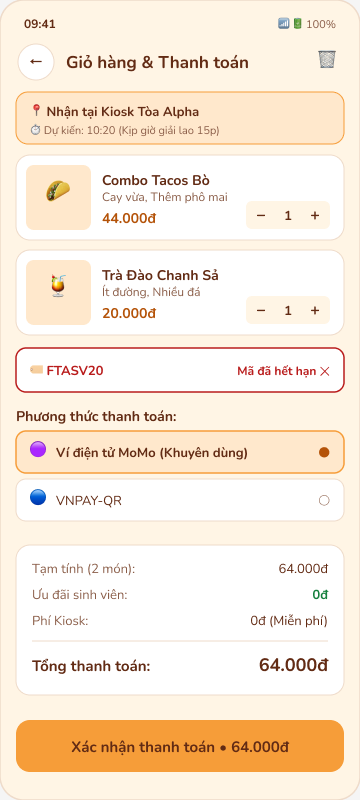
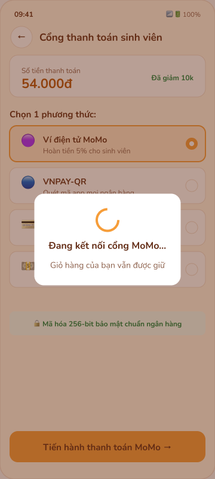
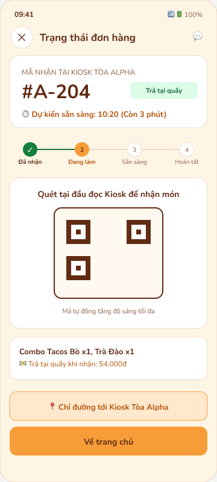
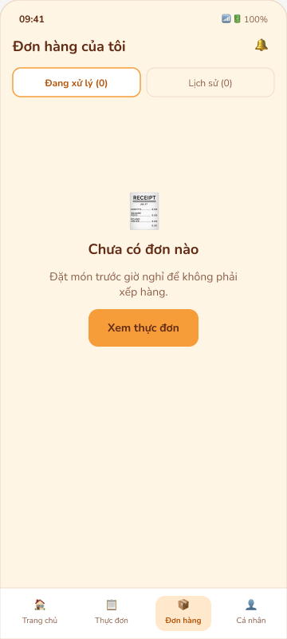

# P4 · Detailed UI Design & Prototyping

> BreakBite · PRM323 Lab 2 · Gate G4 · Ngày lập: 20/10/2026
> Figma: [PRM323](https://www.figma.com/design/VnryhnE4z3159vHoKvx6jL/PRM323?node-id=1-6). Ngày 20/10/2026 đã rà và sửa qua Figma MCP (màu, Variables, mã màn, biến thể, component, liên kết prototype). Chưa chạy thử Present. Điểm UI Checklist ở mục 4 chấm trên ảnh Stitch, là **mức nền**.

## 1. Màn hi-fi (Figma Page 03)

Figma có 6 page: 01 User Flow · 02 Wireframe · 03 Final UI · 04 Design System · 05 Components · 06 Prototype.

| Mã | Màn | Frame trong Figma | Ghi chú |
|---|---|---|---|
| S01 | Onboarding | S01 · Onboarding | ✅ |
| S02 | Trang chủ | S02 · Trang chủ | ⚠️ banner còn lớn (D33) |
| S03 | Thực đơn | S03 · Thực đơn | ✅ đã bỏ sao, có thẻ Tạm hết |
| S04 | Chi tiết món | S04 · Chi tiết món | ⚠️ nút −/+ ~24 dp (D13) |
| S05 | Giỏ hàng | S05 · Giỏ hàng | ⚠️ nút −/+ ~24 dp |
| S06 | Thanh toán | S06 · Thanh toán | ✅ |
| S07 | Theo dõi đơn | S07 · Theo dõi đơn | ✅ |
| S08 | Lịch sử | S08 · Lịch sử | ✅ |
| — | Biến thể | S05-EMPTY · S05-VOUCHER-ERR · S06-LOADING · S06-ERR · S07-CASH · S07-DIALOG · S08-EMPTY | ✅ |

Đã sửa trên mọi page: chữ nút nâu `#622B14`, chữ nhấn `#B45309`, màu gắn Variables, mã màn S01–S08 thống nhất. Page 02 Wireframe vẫn 4/8 màn.

Ảnh xuất từ Figma (20/10/2026) nằm ở `assets/figma/final-ui/`: `S01.png` … `S08.png`, các biến thể (`S05-EMPTY`, `S05-VOUCHER-ERR`, `S06-LOADING`, `S06-ERR`, `S07-CASH`, `S07-DIALOG`, `S08-EMPTY`), wireframe (`WF-*.png`), `user-flow.png`, `design-system.png`, `components.png`.

| S05-VOUCHER-ERR | S06-LOADING | S07-CASH | S08-EMPTY |
|:---:|:---:|:---:|:---:|
|  |  |  |  |

S09–S25: xem `05-P4-ui-design/02-screens-s09-s30.md`.

## 2. Screen / State Coverage Matrix

**F** Figma · **S** Stitch · **D** chỉ có trong đặc tả · **—** không áp dụng

| Màn | Default | Loading | Empty | Error | Success | Điều kiện |
|---|---|---|---|---|---|---|
| S01 | F | — | — | — | — | — |
| S02 | F · S | D | D | D | — | D (quán đóng) |
| S03 | F | D | D | D | — | D (Tạm hết) |
| S04 | F · S | D | — | D (ảnh lỗi) | D (snackbar) | D (món vừa hết) |
| S05 | F · S | D | **F · S** | D (mã sai) | D (mã đúng) | D |
| S06 | F | D | — | **F · S** (S06-ERR) | D | D (QR hết hạn) |
| S07 | F · S | D | — | D | F · S | D (ẩn Huỷ sau 60 giây) |
| S08 | F | D | D | D | — | D |

Figma đã thêm: S06-LOADING, thẻ "Tạm hết" ở S03, S05-VOUCHER-ERR (lỗi mã), S08-EMPTY. Còn thiếu: Loading của S02, S03, S07 và badge quán đóng.

## 3. Prototype (Figma Page 06)

| Flow | Starting point | Đường đi | Tương tác bắt buộc |
|---|---|---|---|
| F1 | S02 | S02 → S04 → S05 → S06 → dialog → loading → S07 | Dialog mở dạng **overlay**; **loading → kết quả** (Smart animate) |
| F2 | S03 | S03 → S04 → S05 (mã sai → mã đúng) → S06 → S07 | Đổi variant Text field error → filled |
| F3 | S06 | S06 → loading → S06-ERR → Thử lại / Trả tiền mặt → S07 | Badge "Trả tại quầy" ở S07 (D31) |

**Back:** màn con quay về màn trước; S07 quay về S02, không về S06. Màn loading không có hotspot (D41).
**Trạng thái trong Figma (Page 06):**
- 40 liên kết; 3 điểm bắt đầu: Flow 1 tại S01, Flow 2 tại S03, Flow 3 tại S06.
- S06 → S06-LOADING → tự chuyển S07 sau 1,2 giây; S06-ERR → S07-CASH.
- Dialog huỷ mở dạng overlay; S05 ↔ S05-VOUCHER-ERR qua ô mã giảm giá.
- Đã bỏ liên kết "bấm đâu cũng chuyển" ở cấp frame.
- **Chưa chạy thử Present**; vị trí overlay (Center) cần đặt tay trong panel Prototype.

## 4. UI Simplicity Checklist — mức nền

Chấm 20 tiêu chí × 5 điểm trên ảnh trong `assets/stitch/`.

| Màn | A Chữ | B Màu | C Mật độ | D Thứ bậc | E Nhất quán + A11y | Tổng |
|---|:---:|:---:|:---:|:---:|:---:|:---:|
| S02 Trang chủ | 10 | 15 | 10 | 10 | 10 | **55** |
| S04 Chi tiết | 10 | 15 | 15 | 20 | 10 | **70** |
| S05 Giỏ + thanh toán | 15 | 20 | 5 | 15 | 10 | **65** |
| S07 Theo dõi | 20 | 20 | 15 | 20 | 10 | **85** |
| S05-EMPTY | 20 | 20 | 20 | 20 | 15 | **95** |
| S06-ERR | 10 | 20 | 10 | 20 | 15 | **75** |

**Tiêu chí trượt chung:** 12 (chữ < 14 sp) và 18 (chữ trắng trên cam 2,14:1) trượt ở mọi màn.

**Lỗi riêng từng màn:**
- **S02:** thông tin trang trí (sao đánh giá, giá gạch, banner flash), ảnh giữ chỗ, nhiều nút + tranh nhau.
- **S05:** giỏ hàng và thanh toán gộp chung một màn.
- **S06-ERR:** lời giải thích dài, lộ mã lỗi.

| Bài test | Kết quả |
|---|---|
| 5 giây | S04, S07, S06-ERR rõ; S02 bị banner hút mắt; S05 không rõ đang ở giỏ hay thanh toán |
| Thang xám | Đạt — trạng thái có icon + chữ |
| Bớt | S02 bỏ được sao, giá gạch, banner mà không mất thông tin (D38) |

**Mục tiêu:** chấm lại trên Figma sau khi sửa; các màn chính phải ≥ 80 (D42).

## 5. Responsive

| Kiểm | Trạng thái |
|---|---|
| 360 dp — lề 16 dp, grid 4 cột | ✅ |
| 412 dp — Fill container, không cuộn ngang | ❌ chưa chụp S02, S04, S05 |
| Nội dung dài — tên món 2 dòng, giá 6 chữ số | ❌ chưa kiểm |
| ≥ 600 dp | Mô tả trong handoff |

## 6. Design Change Log

| QĐ | Thay đổi | Màn | Figma |
|---|---|---|---|
| D01, D02, D04 | Badge quán · giá cộng dồn · huỷ trong 60 giây | S02, S04, S07 | ✅ |
| D10 | Tách Giỏ hàng / Thanh toán | S05, S06 | ✅ |
| D06 | Chữ nút nâu `#622B14` | Toàn app | ✅ |
| D13 | Nút +/- 48 dp | S04, S05 | ❌ |
| D14, D37 | Ảnh món thật 1:1, fallback | S02–S04 | ❌ |
| D15, D36 | Chữ nội dung ≥ 14 sp | Toàn app | ❌ |
| D28, D29 | "Lấy ngay" mặc định · Thêm vào giỏ → S05 | S05, prototype | ❌ |
| D30, D40 | Tạm hết, Loading, quán đóng, lỗi mã | S02, S03, S05, S07 | ⚠️ có Tạm hết, S06-LOADING, lỗi mã; thiếu quán đóng |
| D31 | Badge "Trả tại quầy" | S07 | ✅ S07-CASH |
| D33, D38 | Home theo concept đã chọn; bỏ sao, giá gạch chỉ khi khuyến mãi | S02–S04 | ⚠️ đã bỏ sao; banner S02 còn lớn |
| — | Token màu khớp style guide (chữ phụ, success, error, on-primary) | Page 04 | ✅ |
| — | Component thật có Variant | Page 05 | ✅ 5 Component Set |
| — | Màn dùng instance của component | Page 03 | ❌ |
| D11, D16, D39 | S06-ERR: mã tham chiếu nhỏ, nhãn thống nhất, 2 dòng | S06-ERR | ❌ |

## 7. UI QA Log

| # | Vấn đề | Màn | Mức | Xử lý |
|---|---|---|---|---|
| QA01 | Chữ trắng trên cam 2,14:1 | Toàn app | Blocker | ✅ D06 |
| QA02 | Chữ < 14 sp | S02, S04, S05, S07 | Major | D15 |
| QA03 | Ảnh món giữ chỗ | S02 | Major | D14 |
| QA04 | Thiếu biến thể Loading | S02, S03, S07 | Major | ⚠️ có S06-LOADING; còn S02, S03, S07 |
| QA05 | Prototype chưa chạy thử | Page 06 | Major | Chạy Present |
| QA06 | Chưa kiểm 412 dp, nội dung dài | S02, S04, S05 | Major | Chụp kiểm |
| QA07 | Thông tin trang trí trên thẻ món | S02, S04 | Minor | D38 |
| QA08 | Lời giải thích lỗi dài, lộ mã lỗi | S06-ERR | Minor | D39, D11 |
| QA09 | Mã màn ở Page 01/02 lệch Page 03 | Page 01, 02 | Major | ✅ Đã đổi S01–S08 |
| QA10 | 9 "component" là frame thường, không có Variant | Page 05 | Major | ✅ 5 Component Set mới |
| QA11 | Token lệch style guide; thiếu on-primary | Page 04 | Major | ✅ Đã đổi + tạo Variables |
| QA12 | Mã giảm giá đặt ở Flow 1 thay vì Flow 2 | Page 01 | Minor | ✅ Đã sửa sơ đồ |
| QA13 | Thẻ Spacing và Typography bị cắt nội dung | Page 04 | Minor | ✅ |
| QA14 | Màn là vector phẳng, không dùng instance | Page 03 | Major | Thay dần bằng instance |
| QA15 | Hai bộ biến trùng (`BreakBite Tokens`, `BreakBite Design Tokens`) | Variables | Minor | Xoá bộ cũ |

## 8. AI phản biện và quyết định

Claude Opus 5.5, 20/10/2026. Nguyên văn: `08-ai-log/01-ai-design-log.md` Phụ lục G.

| Phát hiện | Quyết định |
|---|---|
| Thông tin trang trí trên thẻ món | **D38 Modify:** bỏ sao đánh giá; giá gạch chỉ khi có khuyến mãi thật |
| Lời giải thích lỗi dài | **D39 Accept:** rút còn 2 dòng, giữ câu "Giỏ hàng của bạn vẫn được giữ" |
| Figma thiếu biến thể trạng thái | **D40 Accept:** thêm Loading, Tạm hết, quán đóng, lỗi mã |
| Prototype dễ hỏng khi demo | **D41 Accept:** màn loading không có hotspot; Back của S07 về S02 |
| Điểm chấm trên ảnh Stitch | **D42 Accept:** giữ làm mức nền, chấm lại trên Figma |

## 9. Gate G4

| Điều kiện | Kết quả |
|---|:---:|
| **[C]** Flow MVP có đủ màn hi-fi và prototype đi hết tác vụ | ⚠️ Đủ màn và liên kết 3 flow; chưa chạy thử Present |
| **[C]** Dùng đúng style guide/component, không hard-code | ⚠️ Màu gắn Variables; màn chưa dùng instance |
| **[C]** Có empty / loading / error / success / disabled | ✅ S05-EMPTY, S08-EMPTY, S06-LOADING, S06-ERR, S05-VOUCHER-ERR, S07, Button Disabled |
| Có responsive variant, kiểm nội dung thật | ❌ |
| Màn chính ≥ 80 điểm UI Simplicity | ❌ (mức nền 55–75) |
| Có UI QA log, truy vết flow → màn, tồn đọng | ✅ |

**Chưa qua.** Còn làm tay (chi tiết: `README.md mục 7`):
1. Chạy Present cả 3 flow, quay màn hình.
2. Nút −/+ 48 dp ở S04, S05; chữ nội dung ≥ 14 sp.
3. Thay nút, thẻ món, nav bar trên màn bằng instance.
4. Thu nhỏ banner S02 (D33); rút lời lỗi S06-ERR còn 2 dòng (D39).
5. Dựng màn 412 dp, kiểm nội dung dài.
6. Chấm lại UI Checklist trên Figma.
