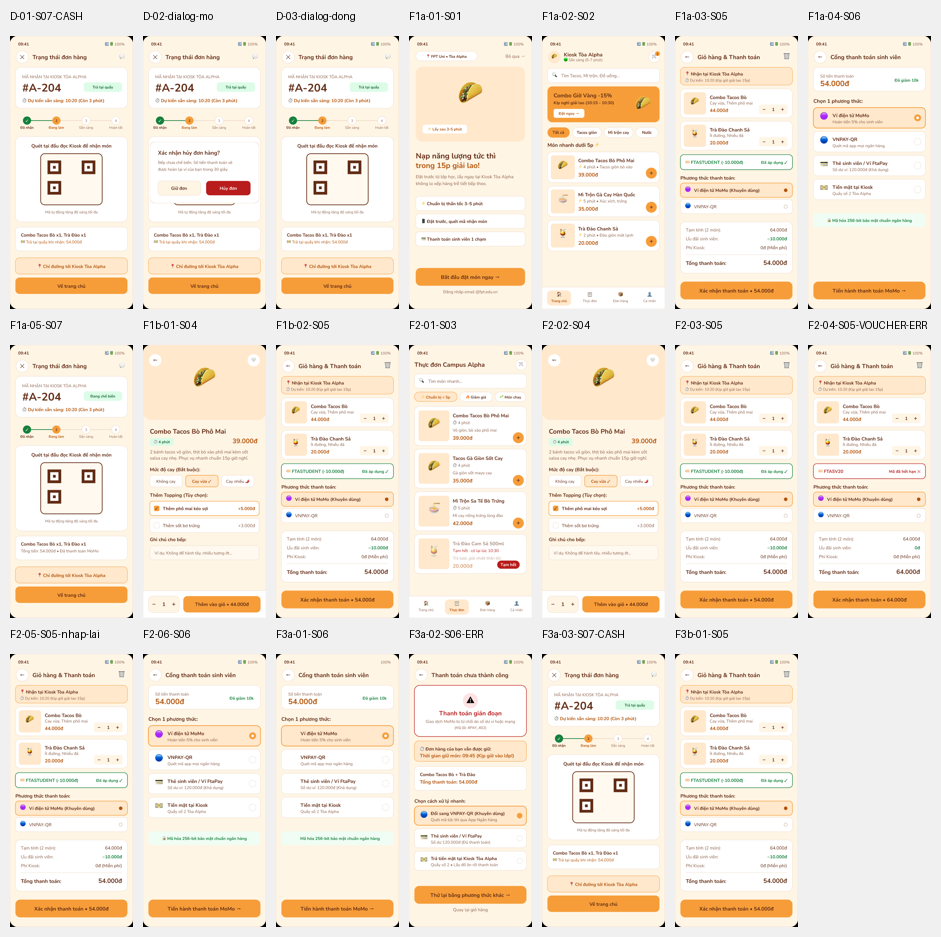

# Báo cáo test Playwright trên prototype Figma — 20/10/2026

> **Cập nhật 24/10/2026:** báo cáo này là của prototype cũ ngày 20/10. Flow đặt món v2 đã đổi: nút + hiện thông báo Xem giỏ, chọn được bốn phương thức, có Cổng thanh toán (chấp nhận hoặc từ chối); đường đặt đơn từ Trang chủ nay tối thiểu 5 chạm. Kiểm đồ thị v2 đạt 10/10 (`PROTO=v2 npx playwright test figma-proto/graph.spec.js`).

- **Đối tượng:** prototype Figma [PRM323](https://www.figma.com/design/VnryhnE4z3159vHoKvx6jL/PRM323?node-id=1-263), Page 06, 15 màn, 40 vùng bấm.
- **Công cụ:** Playwright 1.64.1 + Microsoft Edge (headless, 2× DPR), Windows 11.
- **Mã test:** [`tests/`](../tests/) · hướng dẫn chạy: [`tests/README.md`](../tests/README.md).
- **Kết quả:** **13/13 test đạt** (6 bấm prototype, 7 đồ thị flow); chạy lại ở chế độ so sánh (không cập nhật ảnh chuẩn) vẫn đạt.

## Kết quả từng test

| Nhóm | Test | Kết quả |
|---|---|---|
| Bấm prototype | F1 đường nhanh S01 → S02 → S05 → S06 → S07 | ✅ |
| | F1 đường có chọn topping S02 → S04 → S05 | ✅ |
| | F2 S03 → S04 → S05 → mã sai → nhập lại → S06 | ✅ |
| | F3 S06 → S06-ERR → trả tiền mặt → S07-CASH | ✅ |
| | F3 S06-ERR → quay lại giỏ hàng | ✅ |
| | Dialog huỷ: S07-CASH → mở → Giữ đơn → đóng | ✅ |
| Đồ thị | Không màn cụt | ✅ |
| | Không màn mồ côi (ngoại trừ S08-EMPTY, đã ghi nhận) | ✅ có ghi chú |
| | Danh sách "đã biết" không lỗi thời | ✅ |
| | Mọi liên kết trỏ tới màn có thật | ✅ |
| | F1: đặt đơn S02 → S06 → S07 = **3 chạm** (≤ 8) | ✅ |
| | F2: S03 → S06 ≤ 8 chạm | ✅ |
| | F3: lỗi có lối phục hồi (S07-CASH, S05) | ✅ |

**Kiểm chứng test có phát hiện lỗi:** cố ý đổi vùng bấm "Quick_Add_Tacos" sang chỗ khác thì test F1 hỏng, lệch 47.367 điểm ảnh (21%). Đã khôi phục.

## Phát hiện

| # | Phát hiện | Mức | Xử lý |
|---|---|---|---|
| 1 | **39 vùng bấm (Hotspot) trong Figma có màu cam đặc**, hiện đè lên chữ, nút, ảnh món khi chạy prototype. Có khả năng do lần đổi màu hàng loạt ngày 20/10 làm vùng bấm vốn trong suốt thành cam | **Cao** (prototype nộp bị hỏng giao diện) | **Đã sửa:** xoá màu của 39 vùng bấm, giữ nguyên liên kết; ảnh chuẩn chụp sau khi sửa |
| 2 | **S08-EMPTY không có lối vào nào** trong prototype | Thấp | Ghi nhận trong `graph.spec.js`; khi nối liên kết thì xoá khỏi danh sách |
| 3 | **Prototype F3 khác tài liệu:** lỗi được kích hoạt khi chạm vào *thẻ MoMo* ở S06, còn nút "Tiến hành thanh toán" đi tới thành công. Tài liệu `03-P2-ux-design/04-user-flow.md` ghi "Tiến hành thanh toán → loading → lỗi" | Trung bình | Chưa sửa. Cần chọn: sửa prototype cho lỗi xảy ra sau loading, hoặc sửa tài liệu cho khớp |
| 4 | Sơ đồ Flow 1 trong Figma ghi "Mở Overlay Dialog xác nhận" nhưng prototype không có dialog xác nhận đặt hàng | Thấp | Ghi ở `03-P2-ux-design/04-user-flow.md` mục 5; chưa sửa |
| 5 | Đường S02 → S08 → S07 chỉ 2 chạm nhưng là xem lại đơn cũ, không phải đặt đơn | Thông tin | Test F1 tính đường **có qua S06** (3 chạm) để chỉ số đúng nghĩa; lần viết test đầu đã tính nhầm đường này và đã sửa |

## Không chứng minh được

- Người dùng có hiểu và làm xong việc hay không, mất bao lâu: cần usability test với người thật (G5, chưa làm).
- Thời gian "< 35 giây": test chỉ đếm chạm.
- S09–S25: chưa nối prototype.
- Màn loading trung gian: chỉ kiểm màn đích sau 1,2 giây.
