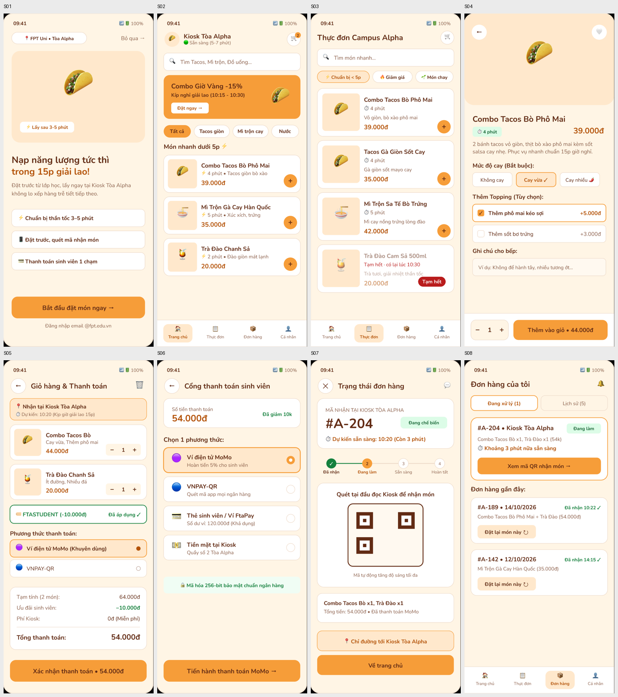

# Báo cáo lỗi giao diện bằng đo tự động — 21/10/2026

> **Quan trọng:** báo cáo này do **Claude Code** (cùng AI đã sửa file Figma) viết, nên **không phải phản biện độc lập**. Phần số đo là khách quan và lặp lại được; phần nhận xét bằng mắt là của Claude. Lab yêu cầu dùng AI *khác* kiểm tra: dùng [`02-prompt-cho-ai-khac.md`](02-prompt-cho-ai-khac.md) để lấy phản biện thứ hai, rồi ghi nguyên văn vào `ai/ai-design-log.md`.

- **Đối tượng:** prototype Figma [PRM323](https://www.figma.com/design/VnryhnE4z3159vHoKvx6jL/PRM323?node-id=1-263), Page 06, 13 màn.
- **Cách đo:** Playwright chụp từng màn từ prototype thật ([`anh/`](anh/), mã `tests/audit/capture.js`); Figma Plugin API đọc chữ, màu, cỡ chữ (`tests/audit/figma-audit.js`); phân tích điểm ảnh và vùng bấm (`tests/audit/measure.py`).
- **Ảnh tổng quan 8 màn lõi:** [`anh/_tong-quan-8-man.png`](anh/_tong-quan-8-man.png)

## 1. Hai điều bạn thấy — đã đo

### A01 · Giao diện quá cam *(Cao)*

| Chỉ số (TB 8 màn lõi) | Giá trị |
|---|---|
| Cam đậm (nút, banner, chữ cam) | **5,9%** điểm ảnh |
| Kem / be (nền trang, thẻ đào, chip đào) | **55,3%** |
| Trắng | 30,6% |
| Màu khác (xanh, đỏ, tím…) | **1,6%** |

- Cam đậm chỉ ~6% nên **không phải nút quá to**; cảm giác "cam quá" đến từ việc **~61% màn hình là một họ màu cam–be** và gần như không có màu trung tính hay màu tương phản. Trong 8 màn lõi, nặng nhất: S01 (74,6% kem/be + hero đào lớn), S04 (71,4%), S06 (59,2%); các màn trạng thái rỗng còn cao hơn (S05-EMPTY 78,9%, S08-EMPTY 86,3%).
- Cùng một họ cam đang đảm nhiệm **mọi vai trò**: nền trang, nền thẻ, banner, chip, nút chính, nút phụ, viền, giá tiền, huy hiệu, trạng thái chọn. Vì vậy mắt không biết nhìn đâu trước. Ví dụ S02: banner cam đặc + ba nút "+" cam + chip "Tất cả" cam + ô tab đào ở thanh dưới cùng cạnh tranh; S07: "Chỉ đường" (nền đào, viền cam) và "Về trang chủ" (cam đặc) nặng gần bằng nhau.
- Palette hiện có 5 tông ấm (`#F69D39`, `#F8A94F`, `#FFE8CC`, `#FFF5E5`, `#B45309`) cộng nâu `#622B14` và viền be, **không có thang xám trung tính**.
- **Hướng sửa gợi ý (bạn quyết):** để cam chỉ cho 1 hành động chính mỗi màn + trạng thái đang chọn; nền thẻ trắng hoặc xám rất nhạt; viền xám trung tính; giá tiền dùng nâu đậm thay vì cam; huy hiệu trạng thái dùng xanh/xám; hero và banner bớt màu đặc. Mục tiêu đo lại: kem/be < ~35%, cam đậm giữ 5–10%.

### A02 · Icon lộn xộn và không liên quan *(Cao)*

- **98/366 chữ trong thiết kế (27%) chứa emoji**; có **30 emoji khác nhau** trên 14 màn, cộng **59 chỗ dùng ký tự văn bản làm icon** (`← → › ✓ ✕ ↻ − + ● ○`). Tức là **ba hệ icon trộn lẫn**: emoji, ký tự chữ, hình tròn màu.
- Emoji **hiển thị khác nhau theo thiết bị** (Android/iOS/Windows) nên giao diện thật sẽ khác ảnh Figma; không đổi được màu, nét, kích thước; đọc màn hình đọc thành tên emoji dài.

| Icon | Dùng ở | Vấn đề |
|---|---|---|
| ⚡ và ⏱ | S01–S03, S05, S07 | **Cùng một nghĩa "thời gian" nhưng hai icon:** S02 ghi "⚡ 4 phút", S03 ghi "⏱ 4 phút". ⚡ còn được dùng cho "Chuẩn bị thần tốc", "Lấy sau", "Món nhanh dưới 5p" |
| 📱 | S01 "Đặt trước, quét mã nhận món" | Điện thoại đen, không gợi nghĩa đặt trước hay quét mã |
| 🟣 🔵 | S05, S06, S06-ERR | Hình tròn màu **thay cho logo MoMo, VNPAY**; người dùng không nhận ra |
| 💳 💵 | S06, S06-ERR | Khác kích thước và phong cách với 🟣🔵 ngay trong cùng danh sách |
| 🏠 📋 📦 👤 | Thanh dưới | Bốn emoji nhiều màu nhỏ (14 sp), 📋 cho "Thực đơn" và 📦 cho "Đơn hàng" kém trực quan |
| 🌮 🍜 🍹 | Ảnh món, logo quán (S02), S01 hero | Emoji làm **ảnh món**; hai món tacos khác nhau cùng một 🌮; 🌮 còn là logo quán |
| 🔥 🌱 | Chip S03 | Chip nhồi emoji, không cùng bộ với phần còn lại |
| 🔒 🏷️ 📍 🟢 🛒 🔍 🗑️ 🔔 💬 🧾 🍽️ ⚠️ 🤍 🌶️ | Rải rác | 💬 ở S07 không có nhãn; 🗑️ xám giữa giao diện cam; 🧾 chỉ xuất hiện một lần |

- **Hướng sửa gợi ý:** một bộ icon duy nhất (ví dụ Material Symbols Rounded, viền, 24 dp, màu theo vai trò); bỏ emoji trang trí; logo ví dùng logo thật; ảnh món là ảnh hoặc minh hoạ riêng từng món; thống nhất một icon cho "thời gian".

## 2. Lỗi khác đo được

### A03 · Giỏ hàng và thanh toán bị lặp *(Cao, lỗi cấu trúc)*
S05 "Giỏ hàng & Thanh toán" đã có **phương thức thanh toán + nút "Xác nhận thanh toán • 54.000đ"**; bấm xong tới S06 "Cổng thanh toán" lại **chọn phương thức thanh toán lần nữa** (4 lựa chọn). Hai màn làm cùng một việc, và nút "Xác nhận thanh toán" xuất hiện *trước* bước chọn cách trả. Trái với quyết định D10 (tách giỏ hàng và thanh toán). Gợi ý: S05 chỉ còn món, mã giảm giá, giờ nhận, tổng tiền, nút "Tiếp tục"; phương thức thanh toán chỉ ở S06.

### A04 · Vùng bấm nhỏ hơn 48 dp *(Cao)*
**20/39** vùng bấm trong prototype nhỏ hơn 48 dp: nút Back và giỏ hàng 45 × 45 (S02–S07), thùng rác 45 × 45, "Voucher" cao 44, "Dialog" 42, "Xem mã QR" cao 40, "Đặt lại món này" cao 32, "Quay lại giỏ hàng" cao 35. Nút −/+ ở S04, S05 trông cỡ ~24 dp. Vi phạm tiêu chí 48 dp mà style guide tự đặt.

### A05 · Chữ nhỏ hơn 14 sp *(Cao)*
**86 dòng chữ < 14 sp** ở 8 màn lõi (S05: 15, S08: 15, S07: 13, S02: 12, S03: 11, S04: 10, S06: 6, S01: 4). Nhãn thanh dưới dùng **10 sp**, trong khi style guide cho phép tối đa ngoại lệ 12 sp (D36). Danh sách: số 9, 10, 11, 12, 13 sp xuất hiện ở mô tả món, giờ, phụ đề.

### A06 · Chữ cam trên nền đào thiếu tương phản *(Vừa)*
`#B45309` trên `#FFE8CC` = **4,23:1** (< 4,5:1) ở 8 chỗ: nhãn tab đang chọn ("Trang chủ", "Thực đơn", "Đơn hàng", cỡ 10 sp), "Cay vừa ✓" (12 sp), dòng "Thời gian giữ món 09:45" ở S06-ERR. Màu chữ cam chỉ đạt 4,65:1 trên nền kem, không đạt trên nền đào. *(Do chính lựa chọn màu `primary-text` của Claude ở bước đổi màu trước.)*

## 3. Lỗi nhận xét bằng mắt (cần AI khác xác nhận)

| ID | Màn | Vấn đề | Mức |
|---|---|---|---|
| A07 | S07 | CTA chính sai: "Về trang chủ" là nút cam đặc, còn việc quan trọng (xem mã QR, huỷ đơn) không nổi bật; "Chỉ đường" cạnh tranh cùng độ nặng | Vừa |
| A08 | S02, S03 | Chip "đang chọn" khác kiểu: S02 nền cam đặc, S03 nền đào viền cam | Vừa |
| A09 | S01 | Hero đào rỗng chiếm ~1/3 màn; ba thẻ tính năng có viền và nền trắng nên trông như nút nhưng không bấm được; link "Đăng nhập email @fpt.edu.vn" mâu thuẫn quyết định D12 (không bắt buộc đăng nhập) | Vừa |
| A10 | S07 | QR chỉ là ba ô vuông, trông như ảnh lỗi | Thấp |
| A11 | S07, S08 | Tên trạng thái lệch: chip "Đang chế biến" nhưng timeline "Đang làm" | Vừa |
| A12 | S02–S05 | Ảnh món là emoji; không phân biệt món | Vừa |
| A13 | S06, S02 | Nội dung không kiểm chứng được: "Mã hoá 256-bit bảo mật chuẩn ngân hàng", "Hoàn tiền 5% cho sinh viên", "Giảm -15%". Dễ bị hỏi nguồn | Vừa |
| A14 | Mọi màn | Thanh trạng thái giả có emoji 📶🔋; nên bỏ hoặc dùng thanh trạng thái thật | Thấp |
| A15 | S03, S05, S07 | Tên món không thống nhất: "Trà Đào Chanh Sả" / "Trà Đào Cam Sả" / "Trà Đào" | Thấp |

## 4. Bảng quyết định (bạn điền sau khi đọc cả hai phản biện)

Quy ước của môn: mỗi phát hiện ghi **Accept / Modify / Reject** kèm lý do, rồi sửa Figma và chụp lại.

| ID | Phát hiện | Quyết định | Lý do | Đã sửa trong Figma | Đã kiểm lại |
|---|---|:---:|---|:---:|:---:|
| A01 | Quá cam | | | ☐ | ☐ |
| A02 | Icon lộn xộn | | | ☐ | ☐ |
| A03 | Giỏ hàng và thanh toán lặp | | | ☐ | ☐ |
| A04 | Vùng bấm < 48 dp | | | ☐ | ☐ |
| A05 | Chữ < 14 sp | | | ☐ | ☐ |
| A06 | Tương phản chữ cam trên nền đào | | | ☐ | ☐ |
| A07–A15 | Các lỗi nhận xét bằng mắt | | | ☐ | ☐ |

Sau khi sửa: chạy lại `node tests/audit/capture.js` và `python tests/audit/measure.py` để có số "sau", và `npm test` trong `tests/` (đồng thời cập nhật ảnh chuẩn nếu đổi giao diện).

## 5. Giới hạn của báo cáo

- Đo trên prototype 13 màn; **S06-LOADING và dialog huỷ đơn không chụp**; 17 màn mở rộng (S09–S25) chưa đo.
- "Cam đậm" và "kem/be" là phân loại màu theo ngưỡng, có sai số nhỏ ở viền chữ.
- Tương phản tính theo lớp tô trên cùng nằm sau chữ trong Figma; có thể bỏ sót chữ nằm trên ảnh hoặc lớp mờ (thẻ "Tạm hết" làm mờ 55% chưa được đánh giá).
- Vùng bấm đo theo vùng prototype, có thể lớn hơn hình nút nhìn thấy.
- Không đánh giá được nội dung chữ tiếng Việt, tông giọng, hoặc người dùng có hiểu không (cần AI khác và người thật).
