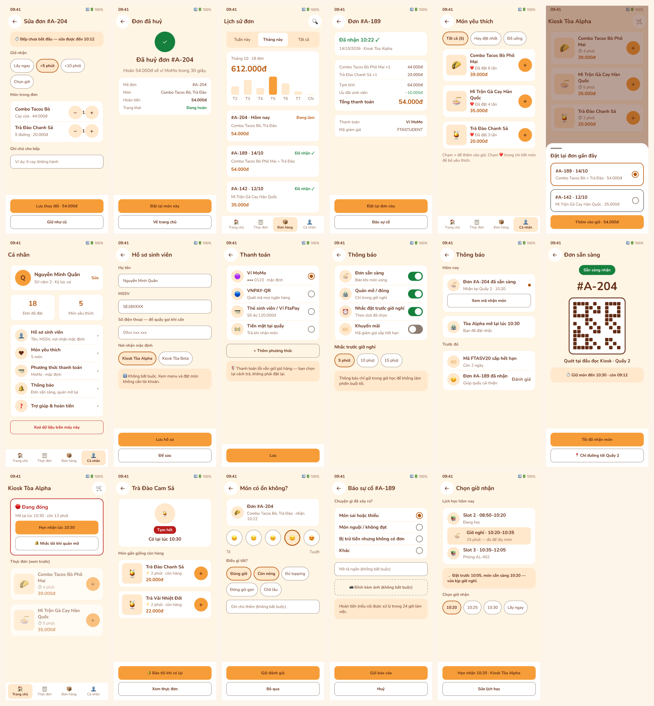
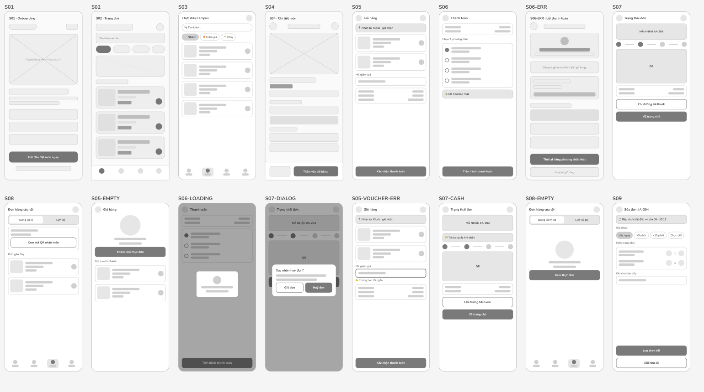
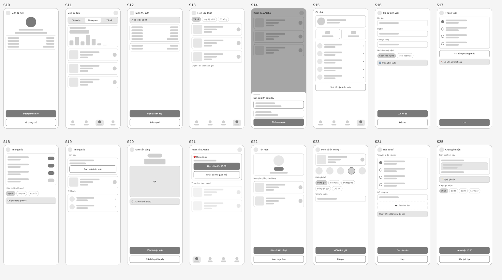

# Màn hình mở rộng — Phase 2 (S09–S25)

> FtaCode Mobile · Figma [PRM323](https://www.figma.com/design/VnryhnE4z3159vHoKvx6jL/PRM323?node-id=1-260), Page 03, **cuối trang** (cuộn xuống dưới khối "IA mở rộng") · Ngày: 20/10/2026
> Ảnh: `assets/figma/ext/` · Tổng quan: `assets/figma/final-ui-phase2/contact-sheet.png`

## 1. Phạm vi và cách đọc tài liệu này

- **Lab 2 giữ nguyên 8 màn lõi (S01–S08)** cùng 3 flow bắt buộc. Phần này là **Phase 2**: 17 màn và 8 flow thêm, để app đủ vòng đời một đơn hàng, không thay thế gì ở bài nộp.
- Cách tổ chức (sơ đồ điều hướng đầy đủ, nhiều flow, mỗi màn đủ trạng thái) học từ file *Why I Buy* của nhóm khác. **Chỉ mượn cách tổ chức**; nội dung, tên màn và giao diện đều là của FtaCode.
- **Mọi màn ở đây là giả thuyết thiết kế, nhãn Assumed.** Chưa có khảo sát hay test người dùng nào xác nhận. Chỉ các ý có thể nối vào insight đã có (INS-01…06) hoặc quyết định D04, D30, D31 mới có cơ sở yếu; còn lại là đề xuất.
- **Rủi ro:** thêm màn làm lệch MVP của P0 (đã chọn phạm vi nhỏ) và dễ bị hỏi "sao nhiều thế". Khi trình bày, nói đây là backlog đã thiết kế sẵn, chưa làm vào MVP.

## 1b. Wireframe và user flow đã vẽ trong Figma

| Loại | Vị trí trong Figma | Số lượng | Ảnh |
|---|---|---|---|
| **Wireframe** | Page 02, phía dưới khung wireframe cũ | 28 khung mới: 5 màn lõi (S03, S05, S06, S07, S08), 6 biến thể, 17 màn Phase 2. Cộng 4 khung có sẵn (S01, S02, S04, S06-ERR) là đủ cả 8 màn lõi và mọi biến thể | `ux/wireframe/wireframes-1.png`, `wireframes-2.png` |
| **User flow** | Page 01, phía dưới 3 flow bắt buộc | 8 flow (F4–F11), 24 chuỗi bước; 7 flow có nhánh lỗi hoặc nhánh phụ (F7 chỉ có nhánh xoá dữ liệu) | `ux/userflow/flows-F4-F7.png`, `flows-F8-F11.png` |

- Wireframe xám, không màu, dùng thứ bậc khối và một nút chính; mỗi khung ghi chú "CTA chính" bên dưới.
- Sơ đồ flow dùng cùng quy ước với 3 flow lõi: nút cam viền đậm = điểm bắt đầu, nút xanh = kết thúc tốt, nút đỏ = lỗi, nút kem = nhánh phụ.
- Wireframe bám đúng bố cục các màn hi-fi ở mục 5; các khung S01, S02, S04, S06-ERR là bản cũ nên kiểu nét hơi khác.

## 2. Vì sao cần thêm màn

| Lỗ hổng ở bản lõi | Màn thêm | Căn cứ |
|---|---|---|
| Tab **Cá nhân** ở thanh dưới không dẫn tới màn nào | S15–S18 | Thanh điều hướng có 4 tab nhưng chỉ 3 có màn |
| Chỉ thấy đơn gần nhất; không xem lại theo tuần/tháng | S11, S12 | P02 nhạy cảm về chi tiêu (US, INS-04) |
| Huỷ đơn có dialog (D04) nhưng không có màn kết quả, và không sửa được đơn | S09, S10 | D04 huỷ trong 60 giây |
| Lúc món xong, người dùng không có màn nhận món rõ ràng cho nhân viên quầy | S19, S20 | Persona P03 (cô Hạnh) cần trả món ~30 giây |
| Quán đóng, món hết chỉ có badge (D30), chưa có hướng đi tiếp | S21, S22 | INS-02 muốn biết trước trạng thái quán |
| Không có phản hồi sau khi nhận món, không có chỗ báo sự cố | S23, S24 | Flow 3 chỉ xử lý lỗi *trước* khi tạo đơn |
| Đặt hàng chưa gắn với giờ nghỉ 15 phút — vấn đề gốc của P0 | S25 | HMW ở P0 |
| Đặt lại món thường mua phải đi qua thực đơn | S13, S14 | Giảm số chạm cho Flow 1 |

## 3. Sơ đồ điều hướng

Ảnh: `ux/userflow/IA-mo-rong.png`. Nền kem = đã có ở Lab 2; viền cam = Phase 2.

| Tab | Màn lõi | Màn Phase 2 |
|---|---|---|
| **S02 Trang chủ** | S04 Chi tiết món, S05 Giỏ hàng, S06 Thanh toán (+ LOADING, ERR), S07 Theo dõi đơn | S14 Đặt lại nhanh, S19 Thông báo, S21 Quán đóng, S25 Hẹn giờ theo slot |
| **S03 Thực đơn** | S04 Chi tiết món | S22 Món hết — gợi ý thay thế |
| **S08 Đơn hàng** | S07 Theo dõi đơn | S11 Lịch sử theo tuần/tháng, S12 Chi tiết đơn, S09 Sửa đơn, S10 Đơn đã huỷ, S20 Nhận món (QR), S23 Đánh giá, S24 Báo sự cố |
| **S15 Cá nhân** | — | S16 Hồ sơ, S17 Thanh toán, S18 Cài đặt thông báo, S13 Món yêu thích |

## 4. Flow mở rộng

Mỗi flow trong Figma có một dải **INPUT → OUTPUT** ở đầu: Input là người dùng đang cần gì, Output là họ nhận được gì khi flow kết thúc tốt.

| Flow | Input — người dùng cần | Output — người dùng nhận được | Đường đi | Màn |
|---|---|---|---|---|
| **F4 Sửa & huỷ đơn** | Muốn đổi giờ nhận, số lượng, ghi chú, hoặc huỷ khi bếp chưa làm (60 giây). | Đơn cập nhật với giờ nhận mới, hoặc hoàn 54.000đ trong 30 giây. | S07 → S09 → lưu → S07; S07 → dialog huỷ → S10 | S09, S10 |
| **F5 Lịch sử & chi tiêu** | Muốn xem lại đã mua gì, tiêu bao nhiêu, và mua lại món cũ nhanh. | Lịch sử theo tuần/tháng kèm tổng chi; đặt lại đơn cũ bằng một chạm. | S08 → S11 (lọc tuần/tháng) → S12 → Đặt lại → S05 | S11, S12 |
| **F6 Yêu thích & đặt lại** | Muốn đặt lại món hay mua mà không lục lại thực đơn. | Món vào giỏ hàng trong ≤ 3 chạm. | S15 → S13 → + → S05; S02 → S14 → Thêm vào giỏ → S05 | S13, S14 |
| **F7 Tài khoản** | Muốn chỉnh hồ sơ, cách trả tiền, thông báo mà không bị ép đăng nhập. | Thiết lập được lưu; vẫn đặt món được khi không có tài khoản. | S15 → S16 / S17 / S18 | S15–S18 |
| **F8 Thông báo & nhận món** | Cần biết khi món xong và nhận món nhanh. | Mã QR mở từ thông báo; nhận món ≤ 30 giây; đơn Hoàn tất. | S02 🔔 → S19 → Xem mã → S20 → Tôi đã nhận món | S19, S20 |
| **F9 Quán đóng & món hết** | Quán đóng hoặc món hết nhưng vẫn muốn có đồ ăn trong giờ nghỉ. | Biết giờ mở, hẹn nhận hoặc được nhắc; hoặc chọn món thay thế. | S02 (đóng) → S21 → Hẹn nhận lúc mở lại; S03 → món hết → S22 → món thay thế | S21, S22 |
| **F10 Sau khi nhận món** | Vừa nhận món, muốn nói món ổn không hoặc báo sự cố. | Đánh giá một chạm; báo sự cố có mã tiếp nhận, hoàn tiền 24 giờ. | S19 / S08 → S23 → gửi; S12 → S24 → gửi | S23, S24 |
| **F11 Đặt theo lịch học** | Giờ nghỉ chỉ 15 phút, cần món sẵn sàng đúng lúc. | Giờ nhận gợi ý theo lịch học; đơn đi tiếp sang thanh toán. | S02 → S25 → chọn giờ → S05 | S25 |

## 5. Danh sách màn

| Mã | Màn | Nội dung chính | Trạng thái thể hiện | Component dùng |
|---|---|---|---|---|
| S09 | Sửa đơn | Đổi giờ nhận, số lượng, ghi chú; hạn sửa 10:12 | Có điều kiện (chỉ khi bếp chưa làm) | Button, TextField |
| S10 | Đơn đã huỷ | Hoàn 54.000đ về MoMo trong 30 giây | Success | Button |
| S11 | Lịch sử tuần/tháng | Tab lọc, tổng chi tháng, biểu đồ 7 cột, danh sách đơn | Default | NavBar |
| S12 | Chi tiết đơn | Hoá đơn, ưu đãi, thanh toán; Đặt lại / Báo sự cố | Default | Button |
| S13 | Món yêu thích | Lọc, số lần đã đặt, thêm vào giỏ 1 chạm | Default | Card/Food, NavBar |
| S14 | Đặt lại nhanh | Bottom sheet chọn đơn gần đây | Overlay | Card/Food, Button, NavBar |
| S15 | Cá nhân | Hồ sơ, số đơn, 5 mục cài đặt, xoá dữ liệu | Default | NavBar |
| S16 | Hồ sơ sinh viên | Họ tên, MSSV, SĐT, nơi nhận mặc định; **không bắt buộc** | Filled / Default | TextField, Button |
| S17 | Phương thức thanh toán | 4 cách trả, chọn mặc định | Selected | Button |
| S18 | Cài đặt thông báo | 4 công tắc, nhắc trước giờ nghỉ | On / Off | — |
| S19 | Thông báo | Hôm nay / trước đó, chấm chưa đọc, nút Xem mã | Unread / Read | — (nút phụ tự dựng) |
| S20 | Nhận món (QR) | Mã #A-204, QR lớn, giữ món đến 10:30 | Ready | Button |
| S21 | Quán đóng | Trạng thái đỏ, hẹn nhận khi mở lại, nhắc, xem trước menu | Closed | Card/Food, Button, NavBar |
| S22 | Món hết | Tạm hết + giờ có lại; hai món thay thế còn hàng | Out of stock | Card/Food, Button |
| S23 | Đánh giá | 5 mặt cười, thẻ lý do, ghi chú | Selected | TextField, Button |
| S24 | Báo sự cố | Lý do, mô tả, ảnh tuỳ chọn, hoàn tiền 24 giờ | Default | TextField, Button |
| S25 | Hẹn giờ theo slot | Lịch học, giờ nghỉ 15 phút, gợi ý giờ nhận | Default | Button |

**Quyết định thiết kế đáng nhớ:**
- **S16 không bắt buộc đăng nhập** — giữ nguyên D12: xem menu và đặt món không cần tài khoản.
- **Không có điểm tích luỹ hay thẻ thành viên** — vẫn là D12 (Reject).
- **S09 chỉ cho sửa giờ, số lượng, ghi chú**, không đổi món — vì bếp bắt đầu làm là phải cố định (ràng buộc của D04).
- **S25 cần người dùng tự nhập lịch học** — app không có dữ liệu thời khoá biểu của trường. Nếu không có nguồn dữ liệu thì bỏ màn này.

## 6. Kiểm tra đã làm trong Figma

| Kiểm | Kết quả |
|---|---|
| Nội dung tràn khỏi khung 360 × 800 | Không có (đo từng màn) |
| Chữ < 14 sp | Chỉ còn nhãn thanh điều hướng 12 sp (ngoại lệ D36); trạng thái pin/sóng 12 sp |
| Điều khiển < 48 dp | Không có sau khi sửa nút −/+ ở S09 (44 → 48) |
| Màu | Mọi màu gắn Variables; dùng cặp màu đã đo ở P3 (chữ nâu trên cam 5,23:1, giá `#B45309` 4,65:1) |
| Component | Footer dùng `Button/Primary`; ô nhập dùng `TextField`; món dùng `Card/Food`; thanh dưới dùng `NavBar` — đều là instance của Page 05 |

**Chưa làm:**
- **Điểm vào S19:** S02 lõi chỉ có biểu tượng giỏ hàng; cần thêm chuông thông báo ở app bar S02 thì flow F8 mới đi được.
- **Nút phụ, công tắc, chip, radio, bottom sheet** đang là khung tự dựng, chưa có Component Set ở Page 05.
- **Nối prototype** cho S09–S25 (chưa có liên kết giữa các màn mở rộng).
- **Wireframe S01, S02, S04, S06-ERR** chưa cập nhật theo D33 (khối trạng thái quán ở S02) và chưa có mã S thống nhất trong khung.
- **Màn 412 dp** và thử nội dung dài.
- **Đo tương phản tự động** — mới kiểm theo cặp màu đã đo ở P3, chưa đo từng chỗ trong file.
- **Phản biện AI và ghi quyết định** (Accept/Modify/Reject) vào `ai/ai-design-log.md`.
- **Kiểm chứng với người dùng** — toàn bộ là giả thuyết.

## 7. Việc nên làm tiếp, theo thứ tự

1. Quyết định có đưa phần nào vào bài nộp không. Gợi ý: **không**; chỉ nhắc ở slide Q&A như backlog.
2. Nếu muốn trình bày: chọn 3–4 màn có căn cứ rõ nhất (S21, S22, S20, S09/S10), nối prototype, chạy thử.
3. Đưa S25 và S21 vào khảo sát lần sau: hỏi lịch học và thái độ khi quán đóng, để có căn cứ.
4. Chạy một vòng phản biện AI cho cả nhóm màn này như P3, P4 đã làm.
