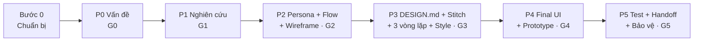
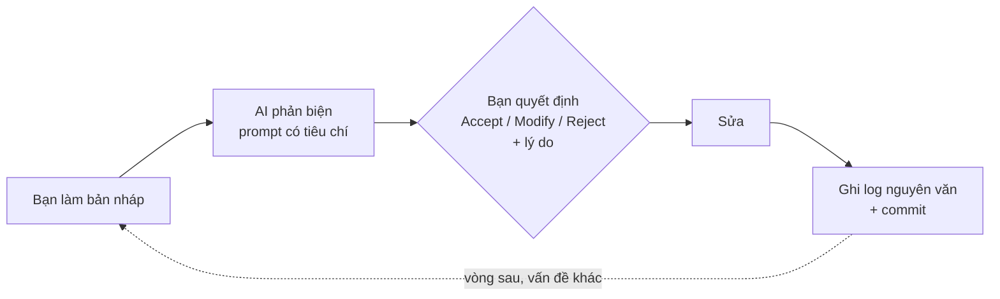

# Làm Lab 2 từ đầu — từng bước, kèm cách cho AI phản biện

Dựa trên [PRM393 UI/UX Material](https://prm393-material.web.app/): quy trình 6 phase P0–P5, Quality Gate G0–G5, Chuẩn chung C1–C8, Persona Guideline, UI Checklist, đề Lab 2. Bản tóm tắt lý thuyết ở `QUY-TRINH-UIUX.md`; file này là **hướng dẫn làm**.

---

## Bức tranh 1 trang



**Vòng lặp dùng ở MỌI phase** (đây là "AI phản biện"):



**4 luật không được phá** (Chuẩn chung C3):
1. Ghi **nguyên văn** prompt và câu trả lời, lưu ảnh kết quả.
2. Mỗi vòng sửa nhắm **một vấn đề có tên**, không trùng vòng khác. "Làm đẹp hơn" không tính.
3. Mỗi đề xuất của AI: **Accept / Modify / Reject**, lý do gắn persona, heuristic hoặc ràng buộc thật. "AI bảo vậy" hay "em thích" không phải lý do.
4. **Persona do AI sinh ra không phải dữ liệu nghiên cứu.** Chưa có bằng chứng thì gắn nhãn **Assumed**.

**Lịch gợi ý (7 ngày):** đề chấm lịch sử Git và lịch sử phiên bản Figma, nên **làm rải nhiều ngày và commit sau mỗi bước**.

| Ngày | Việc |
|---|---|
| 1 | Bước 0 + P0 |
| 2 | P1 (phỏng vấn, đối thủ) |
| 3 | P2 (persona, flow, wireframe) |
| 4 | P3 (DESIGN.md, Stitch, 3 vòng lặp, critique) |
| 5 | P3–P4 (tokens, components, Final UI) |
| 6 | P4 (prototype, checklist) + P5 (test) |
| 7 | P5 (handoff, README, slide, tập demo) |

---

## Bước 0 — Chuẩn bị (30 phút)

1. Chọn đề tài cụ thể và xin giảng viên duyệt. Ví dụ đúng: *"app đặt món cho sinh viên ở KTX có 15 phút nghỉ giữa slot"*; ví dụ sai: *"app đặt đồ ăn"*.
2. Tạo repo GitHub tên **`prm323-lab2-<MSSV>`** với cấu trúc của đề: `ux/`, `design/`, `ai/`, `assets/stitch/`, `assets/figma/`, `handoff/`, `README.md`.
3. Tạo file Figma có **đúng 6 page theo thứ tự**: `01 User Flow` · `02 Wireframe` · `03 Final UI` · `04 Design System` · `05 Components` · `06 Prototype`. Bật chia sẻ "Anyone with the link can view".
4. Tạo `ai/ai-design-log.md` với bảng khai báo công cụ AI. Từ đây, **mọi lần dùng AI đều ghi vào đây**.
5. Commit: `chore: init repo structure`.

---

## P0 — Vấn đề cần giải quyết → Gate G0

**Mục tiêu:** biết rõ vấn đề gì, của ai, vì sao đáng làm. **Chưa vẽ UI.**

| # | Làm gì | Đầu ra |
|---|---|---|
| 1 | Tự nghĩ **2–3 hướng ý tưởng** (ví dụ: app đặt trước tại quầy · màn hình gọi số ở căn tin · đặt qua web QR) | Idea list trong `ux/research.md` |
| 2 | Chọn 1 hướng theo **Impact × Feasibility** (tác động × khả thi), ghi lý do | Dòng "Vì sao chọn" |
| 3 | Viết **problem statement 1 câu**: ai – gặp khó gì – trong bối cảnh nào – hậu quả gì | `ux/persona.md` |
| 4 | Vẽ **Stakeholder / User Map**: ai dùng trực tiếp, ai hỗ trợ, ai liên quan | `ux/research.md` |
| 5 | Lập **Assumption Log**: chia thành Fact / Hypothesis / Unknown | `ux/research.md` |
| 6 | Ghi **MVP scope**: làm gì, không làm gì, rủi ro, chỉ số thành công sơ bộ | `ux/research.md` |

**AI hỗ trợ (tuỳ chọn):**
```text
Tôi đang chọn đề tài cho bài thiết kế app mobile: [mô tả]. Hãy liệt kê 5 hướng giải pháp khác nhau cho vấn đề này,
mỗi hướng nêu ai hưởng lợi, rủi ro lớn nhất và một giả định cần kiểm chứng. Không chấm điểm, không chọn giúp tôi.
```

**AI phản biện:**
```text
Đóng vai giảng viên UX khó tính. Đây là problem statement và assumption log của tôi: [dán].
Kiểm tra: (1) có đủ ai – vấn đề – bối cảnh – hậu quả chưa; (2) chỗ nào tôi đang lẫn giả định với sự thật;
(3) chỗ nào là giải pháp trá hình (nêu tính năng thay vì vấn đề); (4) 3 câu hỏi cần trả lời bằng nghiên cứu ở bước sau.
```

**Tự kiểm G0** — [C] là Critical, chưa đạt thì không qua:
- [ ] **[C]** Problem statement đủ ai – vấn đề – bối cảnh – tác động
- [ ] **[C]** Tách rõ dữ kiện, giả thuyết, ý kiến
- [ ] Có ≥ 2 phương án ý tưởng đã cân nhắc
- [ ] Có nhóm người dùng và stakeholder sơ bộ
- [ ] Có phạm vi MVP, rủi ro, mục tiêu đo
- [ ] **[C]** Có kế hoạch kiểm chứng giả định ở P1

Commit: `docs(ux): problem statement, stakeholder map, assumptions`.

---

## P1 — Nghiên cứu người dùng → Gate G1

**Mục tiêu:** kiểm tra giả định bằng người thật. Lab 2 cho phép làm ở mức tối thiểu, nhưng phần nào chưa có bằng chứng phải gắn nhãn **Assumed**.

| # | Làm gì | Đầu ra |
|---|---|---|
| 1 | Viết **Research Plan**: câu hỏi nghiên cứu, ai, bao nhiêu người, cách hỏi, xin phép | `ux/research.md` |
| 2 | **Phỏng vấn 5–6 người thật** thuộc nhóm mục tiêu (guideline: 6–12 cho lớp học), 5–10 phút mỗi người | Ghi chép ẩn danh, đánh mã **E01, E02…** |
| 3 | Hỏi theo **hành vi đã xảy ra**, không hỏi ý kiến: "lần gần nhất bạn… là khi nào?", "bạn đã làm những bước nào?", "đoạn nào mất thời gian?", "bạn xử lý thế nào khi gặp trở ngại?" | |
| 4 | (Nên làm) **Quan sát** tại chỗ, ví dụ bấm giờ hàng chờ | Ghi chép Observed |
| 5 | **Phân tích đối thủ**: mở 2–3 app/giải pháp đang có, thử làm tác vụ, chụp màn hình | Bảng so sánh |
| 6 | **Affinity map**: mỗi ý một thẻ, gom nhóm theo hành vi, mục tiêu, nỗi đau; ghi mã nguồn trên mỗi thẻ | Ảnh board + bảng |
| 7 | Gắn **nhãn bằng chứng** cho từng ý: Observed / Reported / Inferred / Assumed | |

> Nếu **không kịp phỏng vấn người thật**: có thể phỏng vấn **sinh viên giả lập bằng AI** để tạo giả thuyết (`ux/ai-interview-kit.md`). Phải ghi rõ đó là dữ liệu giả lập, nhãn **Assumed**, và ghi lý do chưa phỏng vấn được người thật trong phần hạn chế.

**AI tổng hợp** (mẫu theo Persona Guideline của môn):
```text
Bạn là UX Research Assistant. CHỈ dùng ghi chú phỏng vấn/quan sát tôi cung cấp; mỗi đoạn có ID nguồn (E01…).
1. Tách observation, reported behavior, goal, pain, constraint.
2. Nhóm theo hành vi, mục tiêu, bối cảnh (không theo tuổi hay giới tính).
3. Đề xuất các nhóm người dùng có khác biệt thật.
4. Mỗi kết luận dẫn ID nguồn; thiếu dữ liệu thì ghi "UNKNOWN / ASSUMPTION".
5. Nêu nhóm người dùng có thể bị bỏ sót và 5 câu hỏi phỏng vấn bổ sung.
6. KHÔNG tạo quote, số liệu hay chi tiết đời tư không có trong ghi chú.
Trả về theo thứ tự: Evidence matrix → Candidate segments → Persona drafts → Open questions.
[DÁN GHI CHÚ]
```

**AI phản biện nghiên cứu:**
```text
Đây là research plan, ghi chép và affinity map của tôi: [dán]. Hãy chỉ ra:
(1) thiên lệch trong cách chọn người và cách đặt câu hỏi; (2) insight nào chỉ có 1 người nói mà tôi đang coi là xu hướng;
(3) kết luận nào không truy về được ghi chép nguồn; (4) điều tôi cần hỏi thêm.
```

**Tự kiểm G1:**
- [ ] **[C]** Có nghiên cứu với người dùng phù hợp, **hoặc** giải trình hợp lý khi chưa làm được
- [ ] **[C]** Insight quan trọng truy về được ghi chép nguồn (có mã E…)
- [ ] Ghi rõ phương pháp, mẫu, giới hạn, thiên lệch
- [ ] Có affinity map / task analysis
- [ ] **[C]** Đã kiểm và cập nhật giả định từ P0
- [ ] Có kết luận nhu cầu ưu tiên và câu hỏi còn mở

**Red flag:** persona hoàn toàn do ChatGPT bịa mà không gắn bằng chứng.

Commit: `docs(ux): research notes, competitor analysis, affinity map`.

---

## P2 — Persona, flow, wireframe → Gate G2

**Mục tiêu:** từ insight ra cấu trúc app và luồng tác vụ, **trước khi tô màu**.

| # | Làm gì | Đầu ra |
|---|---|---|
| 1 | **Persona:** tối thiểu 1 Primary (nên 2–3) đủ **12 trường lõi**: Identity & Archetype, Priority, Usage Context, Goals, Job to Be Done, Current Behaviors, Pain Points, Motivations, Constraints, Key Scenarios, Success Criteria, Evidence & Status. Thêm 4 mục Lab 2: tuổi, vai trò, thiết bị, accessibility | `ux/persona.md` |
| 2 | Mỗi trường ghi **nhãn + mã nguồn** (ví dụ "Reported — E03") | |
| 3 | **Coverage Matrix:** hàng = nhu cầu, cột = persona | `ux/research.md` |
| 4 | **Chỉ số thành công đo được**, ví dụ "đặt xong đơn dưới 35 giây" | `ux/persona.md` |
| 5 | **User stories:** "Là [persona], tôi muốn [việc], để [kết quả]" | `ux/user-flow.md` |
| 6 | **IA:** danh sách **≥ 8 màn**, màn nào cấp cao, màn nào lồng bên trong | `ux/user-flow.md` |
| 7 | **≥ 3 user flow** (Mermaid), mỗi flow có bắt đầu, mục tiêu, kết thúc, happy path, ≥ 1 nhánh thay thế; **≥ 1 flow có lỗi/phục hồi** | `ux/user-flow.md` + Figma 01 |
| 8 | **Bảng flow → màn hình**; mọi màn thuộc ≥ 1 flow | `ux/user-flow.md` |
| 9 | **Wireframe xám** cho mọi màn | Figma 02 |
| 10 | **Walkthrough:** tự đi lại từng flow trên wireframe, hoặc nhờ 1 bạn thử; ghi điểm cần sửa | Ghi chú |

**AI phản biện persona:**
```text
Đóng vai giảng viên UX. Đây là persona và dữ liệu nghiên cứu: [dán ux/persona.md + ux/research.md].
Kiểm tra theo Persona Guideline: (1) đủ 12 trường lõi chưa; (2) trường nào không có bằng chứng mà không gắn nhãn Assumed;
(3) các persona có khác nhau thật về hành vi/ràng buộc, hay chỉ khác tên tuổi; (4) nhu cầu nào đang được viết như tính năng;
(5) chỗ mâu thuẫn (thiết bị, thời gian, bối cảnh); (6) 5 câu khó nhất giảng viên sẽ hỏi.
```

**AI phản biện flow:**
```text
Đây là IA và 3 user flow (Mermaid) của tôi: [dán]. Persona: [tóm tắt]. Hãy tìm:
(1) ngõ cụt hoặc màn hình không ai tới được; (2) bước thừa so với chỉ số thành công [X giây / Y chạm];
(3) nhánh lỗi còn thiếu (mất mạng, nhập sai, hết hàng, huỷ); (4) Back dẫn về đâu ở từng màn.
```

**Tự kiểm G2:**
- [ ] **[C]** Persona/JTBD khác nhau về hành vi và truy về bằng chứng
- [ ] **[C]** Mọi flow ưu tiên rõ bắt đầu, kết thúc, trường hợp lỗi
- [ ] **[C]** Có IA + wireframe low-fi cho các flow MVP
- [ ] Quyết định chức năng nối Insight → Need → User Story
- [ ] Có walkthrough và danh sách điểm cần sửa
- [ ] Đã xét empty / loading / error

**Red flag:** tô màu, làm icon trước khi flow xong; nhiều persona giống nhau chỉ khác tên.

Commit: `docs(ux): personas, IA, 3 flows; figma: wireframes`.

---

## P3 — DESIGN.md → Stitch → 3 vòng lặp → AI critique → Style guide → Gate G3

Đây là phần chiếm nhiều điểm nhất của Lab 2 (tạo UI bằng AI 10 điểm, vòng lặp + phản biện 15 điểm).

### 3.1 Viết `design/DESIGN.md` **trước khi** mở Stitch
Nội dung: tông giọng · bảng màu (vai trò từng màu) · thang chữ · spacing · bo góc · elevation · quy tắc component. **Đo tương phản ngay lúc chọn màu** (chữ thường ≥ 4,5:1, thành phần điều khiển ≥ 3:1). Thêm mục **nguyên tắc thiết kế gắn persona**: mỗi nguyên tắc phục vụ nhu cầu nào của persona nào.

Commit **trước** khi dùng Stitch: `docs(design): DESIGN.md brief`.

### 3.2 Thử ≥ 2 hướng visual trên 1 màn chính (**Critical của G3**)
Trong Stitch, sinh 2 phong cách khác nhau rõ cho cùng một màn (ví dụ Home): A là ấm và ảnh lớn, B là tối giản và nhiều chữ. Lưu ảnh cả hai. So sánh theo persona: đọc ngoài nắng, quét nhanh, một tay. **Chọn 1 và ghi lý do.**

### 3.3 Prompt đầu tiên cho Stitch
Prompt phải có đủ **5 phần** lấy từ DESIGN.md: **persona · task (các màn) · nền tảng (Android, 360 × 800 dp, Material 3) · ràng buộc (48 dp, 14 sp, một nút chính mỗi màn) · phong cách (màu, font)**. Một dòng kiểu "app đặt đồ ăn đẹp" là mất điểm.

→ Dán **nguyên văn** prompt vào log, chụp ảnh **mọi màn** Stitch sinh ra vào `assets/stitch/v1-*.png`. Output phải phủ ít nhất luồng chính.

### 3.4 Ba vòng lặp, mỗi vòng **một vấn đề có tên**
Ví dụ 3 vấn đề khác nhau: (1) nút chính không rõ / tương phản thấp · (2) thiếu empty state · (3) lỗi thanh toán thành ngõ cụt. Mỗi vòng:
1. Chụp ảnh **trước** (`iteration1_before.png`).
2. Viết prompt sửa đúng vấn đề đó, dán nguyên văn vào log.
3. Chụp ảnh **sau** (`iteration1_after.png`). **Hai ảnh phải khác nhau và đúng màn đang sửa.**
4. Kiểm lại kết quả (ví dụ đo lại tương phản). AI hay nói "đã đạt chuẩn" mà thực tế chưa đạt.

### 3.5 AI critique — **≥ 5 phát hiện gắn màn hình cụ thể**
Dùng **một AI khác** (ChatGPT / Gemini / Claude), đưa ảnh các màn:
```text
Đóng vai chuyên gia UX khó tính. Đánh giá các màn hình đính kèm theo:
(a) 10 heuristic của Nielsen, (b) WCAG 2.2 (tương phản 4.5:1 / 3:1, vùng chạm 48 dp, chữ ≥ 14 sp, không dùng màu đơn độc),
(c) persona sau: [dán tóm tắt persona].
Mỗi phát hiện ghi: màn hình · heuristic hoặc tiêu chí · mức độ (cao/vừa/thấp) · vấn đề · đề xuất sửa.
Ít nhất 8 phát hiện. Nêu cả điểm làm tốt. Không khen chung chung.
```
→ Dán **toàn bộ câu trả lời nguyên văn**, không chỉ tóm tắt.

### 3.6 Bảng quyết định
Với mỗi đề xuất quan trọng (của Stitch và của AI critique):

| # | Đề xuất | Màn | Accept / Modify / Reject | Lý do (persona · heuristic · ràng buộc) | Thay đổi trong Figma |
|---|---|---|---|---|---|

Nên có **ít nhất 1 Reject thật**. Thầy gần như chắc chắn hỏi "đề xuất nào em từ chối, vì sao".

### 3.7 Design system trong Figma
- **Page 04:** token bằng **Variables** (màu, chữ, spacing, radius, elevation). Light theme là bắt buộc.
- **Page 05:** **9 component**, dựng bằng Auto Layout + variant, đủ state:

| Component | State bắt buộc |
|---|---|
| Button | default, pressed, disabled, loading |
| Text field | default, focused, filled, error, disabled |
| Card | default, pressed (nếu bấm được) |
| Navigation | mỗi đích ở trạng thái được chọn |
| App bar | default, có action |
| Dialog | xác nhận + 1 bản destructive hoặc lỗi |
| Loading | skeleton hoặc spinner |
| Empty | icon + câu + 1 hành động |
| Error | thông báo + nguyên nhân dễ hiểu + nút thử lại |

Component phải **dùng token**; màu hoặc kích thước gán cứng bị trừ điểm.

**Tự kiểm G3:**
- [ ] **[C]** Có ≥ 2 hướng visual, chọn có lý do theo persona/task
- [ ] **[C]** Style guide có color roles, type scale, spacing, grid, density, component states
- [ ] **[C]** Tương phản 4,5:1 / 3:1, vùng chạm ≥ 48 dp, chữ ≥ 14 sp
- [ ] Màn chính có thứ bậc rõ, ít chữ thừa, màu nhấn có vai trò
- [ ] Token và component đặt tên dùng lại được
- [ ] Đã thử concept với nội dung dài, màn 360 dp

Commit sau **mỗi vòng lặp**: `feat(stitch): iteration 2 — empty state`, …

---

## P4 — Final UI + Prototype → Gate G4

| # | Làm gì | Đầu ra |
|---|---|---|
| 1 | **Page 03:** ≥ 8 màn 360 × 800 dp, **chỉ dùng instance** của component (không detach); biến thể trạng thái đặt **cạnh** màn gốc | Figma 03 |
| 2 | Mỗi màn liên quan có đủ state: default, loading, empty, error, success | |
| 3 | **Kiểm 360 và 412 dp:** nhân bản frame, đổi rộng 412, xem có vỡ không; chụp ảnh | `assets/figma/` |
| 4 | **Page 06 Prototype:** 3 flow bấm được từ đầu tới cuối, mỗi flow có **starting point**; ≥ 1 dialog dạng **overlay**; ≥ 1 chuyển cảnh **loading → kết quả**; Back đúng; không ngõ cụt | Figma 06 |
| 5 | Chấm **UI Simplicity Checklist** (20 tiêu chí) cho từng màn chính, mục tiêu **≥ 80 điểm** | Ghi điểm |
| 6 | Làm 3 bài test nhanh: **5 giây** (nhìn 5 giây có hiểu không) · **thang xám** (có phụ thuộc màu không) · **bớt** (bỏ thứ trang trí có mất thông tin không) | Ghi kết quả |
| 7 | Viết `design/design-decisions.md` (≤ 10 quyết định quan trọng + bảng accessibility có số đo) và `design/screen-spec.md` (mục đích, nội dung, flow của từng màn) | |
| 8 | Xuất PNG từ **chính Figma** vào `assets/figma/` | |

**AI phản biện bản hi-fi** (chạy sau khi xong Page 03):
```text
Đây là ảnh các màn hình cuối và bảng quyết định trước đó: [đính kèm]. Hãy:
(1) chấm từng màn theo 20 tiêu chí UI Simplicity (text, màu, mật độ, thứ bậc, nhất quán + accessibility), nêu tiêu chí trượt;
(2) chỉ ra chỗ cùng một thành phần nhưng trông hoặc đặt tên khác nhau giữa các màn;
(3) kiểm tra các quyết định trước đó đã thực sự được áp dụng chưa; (4) state nào còn thiếu.
```

**Tự kiểm G4:**
- [ ] **[C]** Mọi flow MVP có đủ màn hi-fi và prototype đi hết tác vụ
- [ ] **[C]** Dùng đúng style guide/component, không gán cứng
- [ ] **[C]** Có empty/loading/error/success/disabled phù hợp
- [ ] Có variant responsive, kiểm với nội dung thật
- [ ] Màn chính ≥ 80 điểm UI Simplicity
- [ ] Có QA log, truy vết flow → màn, danh sách tồn đọng

Commit: `feat(figma): final UI, prototype; docs: design decisions, screen spec`.

---

## P5 — Kiểm thử, bàn giao, bảo vệ → Gate G5

| # | Làm gì | Đầu ra |
|---|---|---|
| 1 | **Usability test** 3–5 người: giao task ("đặt một combo và chọn giờ nhận"), **không hướng dẫn từng bước**; ghi thành công/thất bại, thời gian, số chạm, chỗ vướng | Test log |
| 2 | Xếp lỗi: P0 blocker / P1 major / P2 minor; sửa P0–P1, test lại | Issue list |
| 3 | So kết quả với **chỉ số thành công** của persona | |
| 4 | `handoff/flutter-handoff.md`: **mỗi màn đủ 6 mục**: layout · components · states · interactions (kể cả quy tắc validate) · navigation (Back đi đâu) · UI constraints (vùng chạm, bàn phím, tràn chữ, độ dài tối đa, màn ≥ 600 dp) | |
| 5 | **2 bảng toàn cục:** token → Flutter (`ColorScheme`, `TextTheme`, hằng số) · component → widget (`FilledButton`, `TextFormField`, `NavigationBar`, `AlertDialog`…) | |
| 6 | **README:** đề tài, persona 1 dòng, link Figma, danh sách AI đã dùng, bản đồ vị trí từng sản phẩm | |
| 7 | Mở link Figma và GitHub bằng **cửa sổ ẩn danh** | |
| 8 | Slide 12 trang + tập demo 7 bước (`slides/`) | |

**Bài test handoff:** đưa handoff cho một bạn, nhờ dựng thử một màn chỉ nhìn Figma để xem hình. Câu nào bạn ấy phải hỏi lại là chỗ handoff còn thiếu.

**AI phản biện handoff:**
```text
Đóng vai lập trình viên Flutter chưa biết gì về dự án. Đọc handoff dưới đây và liệt kê mọi câu bạn phải hỏi lại
mới dựng được màn [tên màn]: kích thước, khoảng cách, trạng thái, quy tắc validate, điều hướng, hành vi trên màn rộng.
[dán handoff/flutter-handoff.md]
```

**Tự kiểm G5:**
- [ ] **[C]** Có usability test với người đại diện, hoặc lý do ngoại lệ được ghi
- [ ] **[C]** Không còn blocker trong tác vụ MVP
- [ ] **[C]** Có findings theo task, ưu tiên sửa, retest
- [ ] **[C]** Bàn giao đủ flow, màn, state, component, token, asset, interaction spec
- [ ] Có acceptance criteria, tồn đọng, người chịu trách nhiệm
- [ ] Có người xác nhận đủ rõ để triển khai

**Red flag:** "đã test" nhưng chỉ cho bạn bè xem rồi nhận lời khen.

Commit: `docs(handoff): flutter handoff + mapping tables; docs: README`.

---

## Mẫu ghi log cho MỖI lần dùng AI

```markdown
### [I0x hoặc tên vòng] — Vấn đề: [tên vấn đề cụ thể]
- Công cụ: [Stitch / ChatGPT / Gemini / Claude] · Ngày: [dd/mm/yyyy]
- Prompt (nguyên văn):
  ```text
  ...
  ```
- Câu trả lời / output (nguyên văn hoặc ảnh): ...
- Ảnh trước: assets/stitch/... · Ảnh sau: assets/stitch/...
- Kiểm lại: [đo tương phản / đếm chạm / thử flow] → kết quả
- Quyết định: D0x — Accept / Modify / Reject — lý do: [persona / heuristic / ràng buộc]
- Thay đổi trong Figma: [frame / component nào]
```

## Mã định danh nên dùng (Chuẩn chung C7)

**E01** bằng chứng · **P01** persona · **F01** flow · **S01** màn hình · **I01** vòng lặp AI · **D01** quyết định · **T01** test case.
Chuỗi truy vết: **E → Insight → P / Need → User story → F → S → T**. Một bảng Excel nối các mã này (như `ux/persona-mapping.xlsx`) là cách dễ nhất để trả lời "sao em làm cái này".

## Trước hạn nộp (rubric 100 điểm)

| Phần | Điểm | Kiểm nhanh |
|---|---|---|
| Phân tích UX & user flow | 15 | Persona cụ thể, IA, ≥ 3 flow có nhánh, bảng flow → màn |
| Tạo UI bằng AI | 10 | Prompt nguyên văn đủ 5 phần; ảnh Stitch phủ luồng chính |
| Vòng lặp & phản biện | 15 | 3 vòng khác vấn đề có ảnh trước/sau; ≥ 5 phát hiện gắn màn; quyết định có lý do |
| Final UI/UX | 20 | Thứ bậc, nhất quán, đủ state, accessibility 360/412 dp |
| Design system & components | 15 | Variables được dùng; 9 component đủ state; màn dùng instance |
| Prototype | 10 | 3 flow có starting point, overlay, loading → kết quả, Back đúng |
| Flutter handoff | 10 | 6 mục/màn + 2 bảng mapping |
| Tài liệu & AI log | 5 | Log đủ, truy về được ảnh; repo đúng cấu trúc; link mở được |
