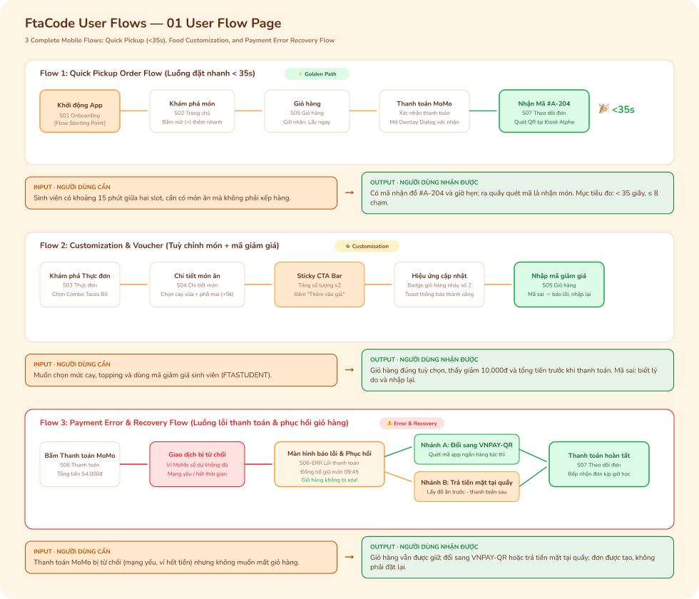
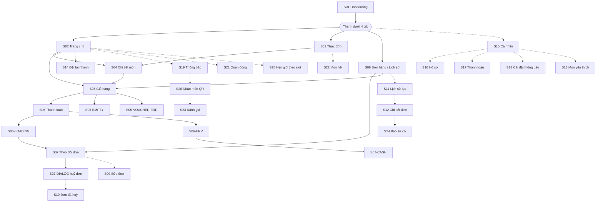
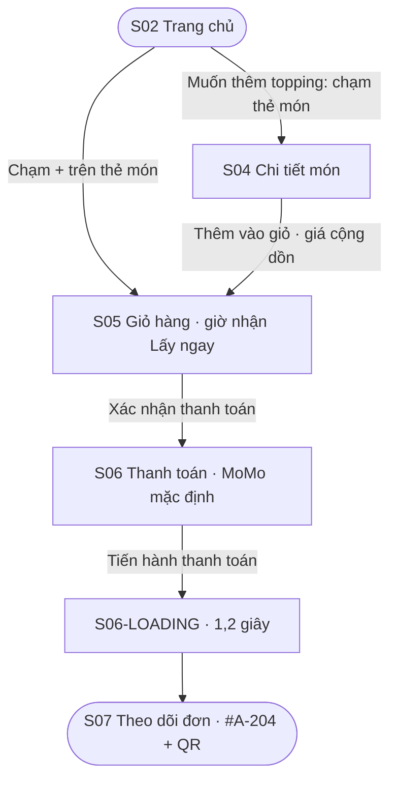
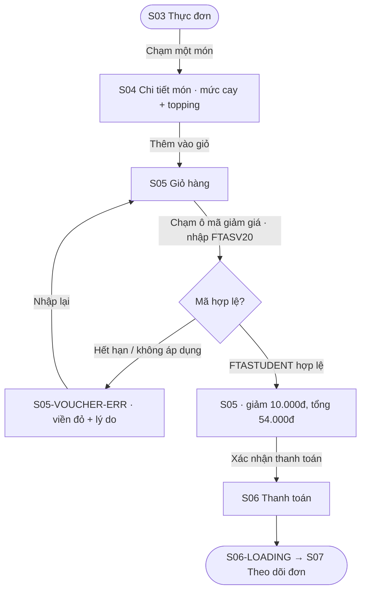
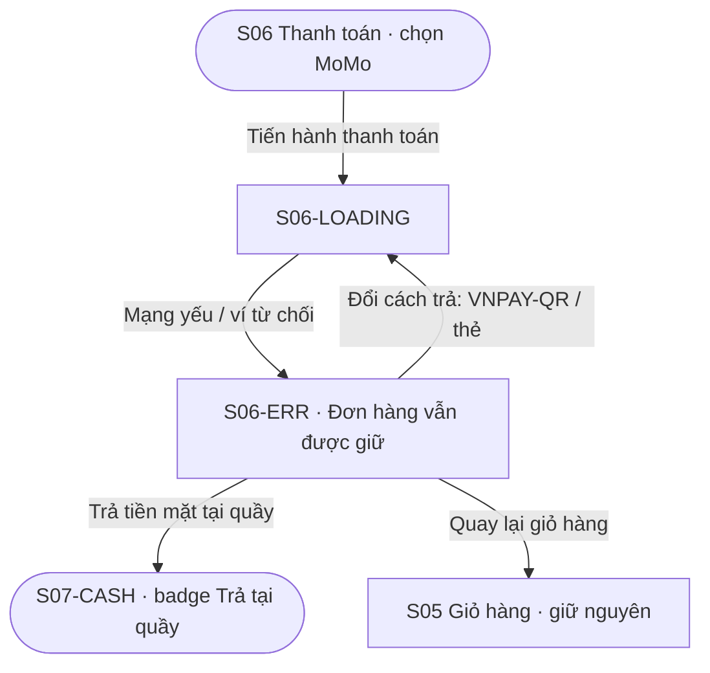
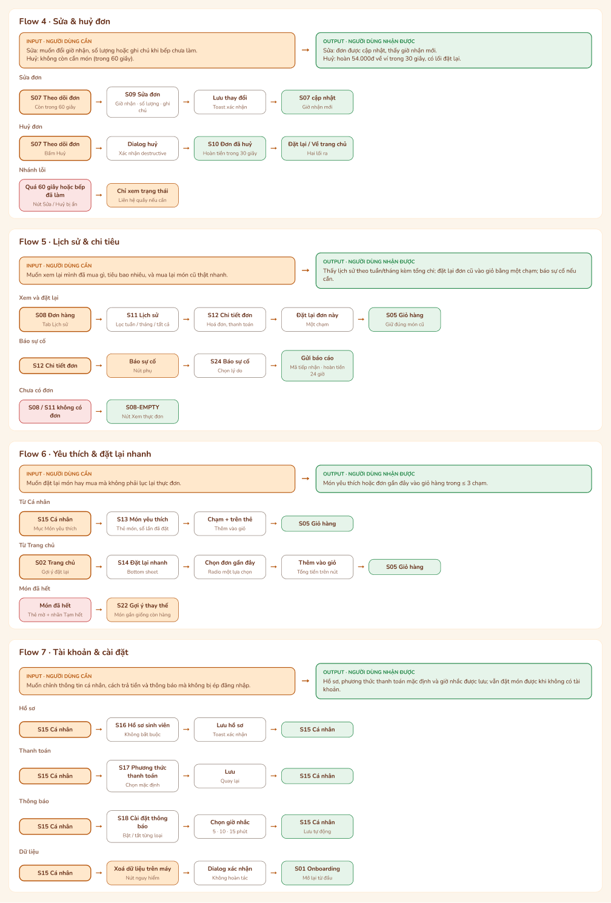
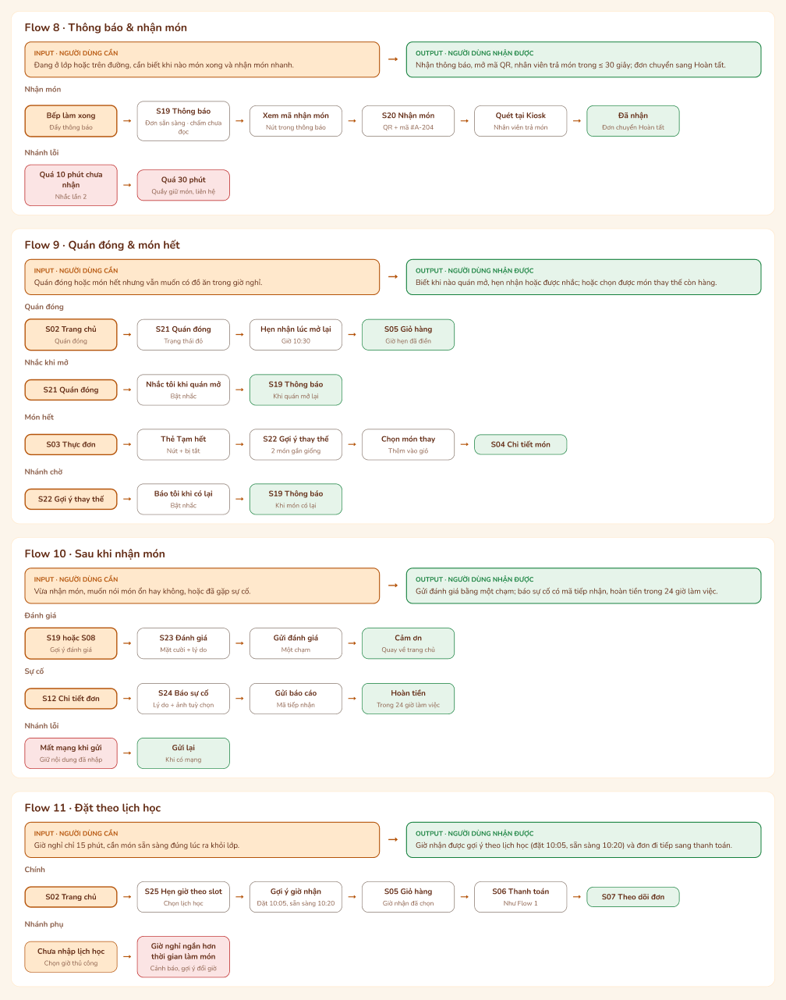

# Kiến trúc thông tin và User Flow

> FtaCode Mobile · PRM323 Lab 2 · Ngày cập nhật: 20/10/2026
> Figma: [PRM323](https://www.figma.com/design/VnryhnE4z3159vHoKvx6jL/PRM323?node-id=1-6) · Sơ đồ flow: Page 01 · Wireframe: Page 02 · Màn hi-fi: Page 03 · Prototype: Page 06

## 0. Cách đọc

Mỗi flow gồm:
- **Input** — người dùng đang cần gì khi bắt đầu.
- **Output** — người dùng nhận được gì khi kết thúc tốt.
- **Đường đi** — các màn theo thứ tự, và **nhánh lỗi / nhánh phụ**.
- **Căn cứ** — insight hoặc quyết định thiết kế đứng sau.

App có 11 flow: **F1–F3** là ba flow bắt buộc của Lab 2 (có nhánh lỗi, đã nối prototype); **F4–F11** mô tả các màn S09–S25 (xem `design/screens-s09-s25.md`).

Mã màn: **S01–S25**; biến thể gắn hậu tố (`S06-ERR`, `S05-EMPTY`…).

---

## 1. Kiến trúc thông tin

Điều hướng chính là **thanh dưới 4 tab**, thao tác một tay. Các màn con mở từ tab hoặc từ nhau và luôn có nút Back về màn trước.

| Tab | Màn gốc | Ghi chú |
|---|---|---|
| Trang chủ | S02 | Trạng thái quán, món lấy nhanh |
| Thực đơn | S03 | Danh mục, tìm kiếm |
| Đơn hàng | S08 | Đơn đang xử lý và lịch sử; mở S07 để xem mã nhận |
| Cá nhân | S15 | Hồ sơ, thanh toán, thông báo, món yêu thích |

### 1.1 Sơ đồ màn hình

Nét liền = màn S01–S08. Nét đứt = màn S09–S25.

### 1.2 Danh mục màn S01–S08

| Mã | Màn | Cấp | Nội dung chính |
|---|---|---|---|
| S01 | Onboarding | Vào app | Giá trị cốt lõi, nút Bắt đầu và Bỏ qua. Chỉ hiện lần đầu |
| S02 | Trang chủ | Tab 1 | Tên quầy và trạng thái, banner, danh mục, món lấy nhanh dưới 5 phút |
| S03 | Thực đơn | Tab 2 | Bộ lọc, danh sách món, nút + thêm nhanh |
| S04 | Chi tiết món | Con | Mức cay, topping, ghi chú; nút ghim đáy có giá cộng dồn |
| S05 | Giỏ hàng | Con | Món và số lượng, mã giảm giá, giờ nhận (mặc định Lấy ngay), tổng tiền |
| S06 | Thanh toán | Con | Chọn một phương thức (MoMo, VNPAY-QR, thẻ/ví, tiền mặt) |
| S07 | Theo dõi đơn | Con | Mã nhận #A-204, QR, tiến trình 4 bước, nút Huỷ trong 60 giây |
| S08 | Đơn hàng / Lịch sử | Tab 3 | Đang xử lý và lịch sử; Đặt lại món này; Xem mã QR |

**Biến thể trạng thái:** S05-EMPTY (giỏ trống), S05-VOUCHER-ERR (mã sai), S06-LOADING (đang kết nối cổng), S06-ERR (lỗi thanh toán), S07-CASH (trả tại quầy), S07-DIALOG (xác nhận huỷ), S08-EMPTY (chưa có đơn).

---

## 2. Ba flow bắt buộc

### F1 · Đặt nhanh, nhận tại quầy *(Happy path)*

> **Input — người dùng cần:** Có khoảng 15 phút giữa hai slot, cần có món ăn mà không phải xếp hàng.
> **Output — người dùng nhận được:** Mã nhận đồ #A-204 và giờ hẹn; ra quầy quét mã là nhận món.

- **Bắt đầu:** S02 Trang chủ (S01 chỉ lần đầu mở app). **Kết thúc:** S07 Theo dõi đơn.
- **Số chạm theo prototype:** đường nhanh **3 chạm** (+ trên thẻ món → Xác nhận thanh toán → Tiến hành thanh toán); đường có chọn topping qua S04 **5 chạm**. Mục tiêu bài là < 35 giây, ≤ 8 chạm; **chưa đo với người thật**.
- **Căn cứ:** INS-01 (hàng chờ dồn giờ nghỉ), INS-04 (thấy tổng tiền sớm), D28 (mặc định "Lấy ngay").

**Nhánh phụ:** quán đóng → S21; giỏ trống → S05-EMPTY → S03; đơn cũ → S08 → Đặt lại → S05.

---

### F2 · Tuỳ chỉnh món và mã giảm giá *(Alternative path)*

> **Input — người dùng cần:** Muốn chọn mức cay, topping và dùng mã giảm giá sinh viên.
> **Output — người dùng nhận được:** Giỏ hàng đúng tuỳ chọn, thấy giảm 10.000đ và tổng tiền **trước** khi thanh toán. Nếu mã sai: biết lý do và nhập lại.

- **Bắt đầu:** S03 Thực đơn. **Kết thúc:** S07 Theo dõi đơn.
- **Căn cứ:** INS-04 (ngại phí ẩn, muốn thấy tổng sớm), persona P02, D03 (lỗi mã nói rõ lý do).

---

### F3 · Lỗi thanh toán và phục hồi *(Error path — bắt buộc)*

> **Input — người dùng cần:** Thanh toán MoMo bị từ chối (mạng yếu, ví không đủ tiền) nhưng không muốn mất giỏ hàng.
> **Output — người dùng nhận được:** Giỏ hàng vẫn được giữ; đổi sang VNPAY-QR hoặc trả tiền mặt tại quầy; đơn vẫn được tạo, không phải đặt lại.

- **Bắt đầu:** S06 Thanh toán. **Kết thúc:** S07-CASH Theo dõi đơn (trả tại quầy).
- **Lỗi:** cổng thanh toán timeout hoặc từ chối → S06-ERR, giải thích 2 dòng, **không lộ mã lỗi kỹ thuật** (D39, D11).
- **Căn cứ:** INS-06 (mất giỏ khi lỗi — chỉ 1 nguồn mô phỏng; giữ flow vì đề bắt buộc, D24), DP5 (không bao giờ xoá giỏ khi lỗi), D16 (nhãn nút thống nhất), D31 (badge Trả tại quầy).

---

## 3. Flow F4–F11

### F4 · Sửa và huỷ đơn
> **Input:** Muốn đổi giờ nhận, số lượng, ghi chú, hoặc huỷ khi bếp chưa làm (trong 60 giây).
> **Output:** Đơn cập nhật với giờ nhận mới, hoặc hoàn 54.000đ về ví trong 30 giây.

- **Sửa:** S07 → S09 Sửa đơn → Lưu thay đổi → S07 (giờ nhận mới).
- **Huỷ:** S07 → S07-DIALOG → S10 Đơn đã huỷ → Đặt lại hoặc Về trang chủ.
- **Nhánh lỗi:** quá 60 giây hoặc bếp đã làm → nút Sửa/Huỷ ẩn, chỉ xem trạng thái, liên hệ quầy.
- **Căn cứ:** D04 (huỷ trong 60 giây).

### F5 · Lịch sử và chi tiêu
> **Input:** Muốn xem lại đã mua gì, tiêu bao nhiêu, và mua lại món cũ nhanh.
> **Output:** Lịch sử theo tuần/tháng kèm tổng chi; đặt lại đơn cũ vào giỏ bằng một chạm.

- **Chính:** S08 → S11 (lọc tuần / tháng / tất cả) → S12 Chi tiết đơn → Đặt lại đơn này → S05.
- **Báo sự cố:** S12 → S24 → Gửi báo cáo (mã tiếp nhận, hoàn tiền 24 giờ).
- **Chưa có đơn:** S08-EMPTY → Xem thực đơn.
- **Căn cứ:** persona P02 (nhạy cảm chi tiêu).

### F6 · Yêu thích và đặt lại nhanh
> **Input:** Muốn đặt lại món hay mua mà không lục lại thực đơn.
> **Output:** Món vào giỏ hàng trong ≤ 3 chạm.

- **Từ Cá nhân:** S15 → S13 Món yêu thích → chạm + → S05.
- **Từ Trang chủ:** S02 → S14 Đặt lại nhanh (bottom sheet) → chọn đơn gần đây → Thêm vào giỏ → S05.
- **Nhánh phụ:** món đã hết → thẻ mờ + nhãn Tạm hết → S22 Gợi ý thay thế.

### F7 · Tài khoản và cài đặt
> **Input:** Muốn chỉnh hồ sơ, cách trả tiền, thông báo mà không bị ép đăng nhập.
> **Output:** Thiết lập được lưu; vẫn đặt món được khi không có tài khoản.

- **Hồ sơ:** S15 → S16 (không bắt buộc) → Lưu → S15.
- **Thanh toán:** S15 → S17 → chọn mặc định → Lưu → S15.
- **Thông báo:** S15 → S18 → bật/tắt, chọn giờ nhắc 5/10/15 phút → S15.
- **Dữ liệu:** S15 → Xoá dữ liệu trên máy → dialog xác nhận → S01.
- **Căn cứ:** D12 (không bắt buộc đăng nhập, không điểm tích luỹ).

### F8 · Thông báo và nhận món
> **Input:** Cần biết khi món xong và nhận món nhanh.
> **Output:** Mã QR mở thẳng từ thông báo; nhận món trong ≤ 30 giây; đơn chuyển Hoàn tất.

- **Chính:** bếp làm xong → S19 Thông báo → Xem mã nhận món → S20 → quét tại Kiosk → nhân viên trả món.
- **Nhánh lỗi:** quá 10 phút chưa nhận → nhắc lần 2; quá 30 phút → quầy giữ món, liên hệ.
- **Căn cứ:** persona P03 (cô Hạnh: trả món ~30 giây).

### F9 · Quán đóng và món hết
> **Input:** Quán đóng hoặc món hết nhưng vẫn muốn có đồ ăn trong giờ nghỉ.
> **Output:** Biết giờ mở, hẹn nhận hoặc được nhắc; hoặc chọn được món thay thế còn hàng.

- **Quán đóng:** S02 → S21 → Hẹn nhận lúc mở lại → S05 (giờ hẹn đã điền); hoặc Nhắc tôi khi quán mở → S19.
- **Món hết:** S03 → thẻ Tạm hết → S22 → chọn món thay → S04; hoặc Báo tôi khi có lại → S19.
- **Căn cứ:** INS-02 (muốn biết trước trạng thái quán), D30.

### F10 · Sau khi nhận món
> **Input:** Vừa nhận món, muốn nói món ổn hay không, hoặc đã gặp sự cố.
> **Output:** Đánh giá một chạm; báo sự cố có mã tiếp nhận, hoàn tiền trong 24 giờ làm việc.

- **Đánh giá:** S19 hoặc S08 → S23 → Gửi đánh giá → Cảm ơn.
- **Sự cố:** S12 → S24 → Gửi báo cáo → mã tiếp nhận.
- **Nhánh lỗi:** mất mạng khi gửi → giữ nội dung đã nhập, gửi lại khi có mạng.

### F11 · Đặt theo lịch học
> **Input:** Giờ nghỉ chỉ 15 phút, cần món sẵn sàng đúng lúc.
> **Output:** Giờ nhận gợi ý theo lịch học (đặt 10:05, sẵn sàng 10:20); đơn đi tiếp sang thanh toán.

- **Chính:** S02 → S25 → chọn lịch học → gợi ý giờ nhận → S05 → S06 → S07.
- **Nhánh phụ:** chưa nhập lịch học → chọn giờ thủ công; giờ nghỉ ngắn hơn thời gian làm món → cảnh báo, gợi ý đổi giờ.
- **Lưu ý:** app không có dữ liệu thời khoá biểu của trường, người dùng phải tự nhập. Nếu không có nguồn dữ liệu thì bỏ flow này.

---

## 4. Ma trận flow × màn hình

Mọi màn đều thuộc ít nhất một flow, không có màn mồ côi. ● = có trong flow; ◐ = nhánh phụ hoặc tuỳ chọn.

| Màn | F1 | F2 | F3 | F4 | F5 | F6 | F7 | F8 | F9 | F10 | F11 |
|---|:-:|:-:|:-:|:-:|:-:|:-:|:-:|:-:|:-:|:-:|:-:|
| S01 Onboarding | ◐ |  |  |  |  |  | ● |  |  |  |  |
| S02 Trang chủ | ● |  |  |  |  | ● |  |  | ● |  | ● |
| S03 Thực đơn |  | ● |  |  |  |  |  |  | ● |  |  |
| S04 Chi tiết món | ◐ | ● |  |  |  |  |  |  | ● |  |  |
| S05 Giỏ hàng | ● | ● | ◐ |  | ● | ● |  |  | ● |  | ● |
| S05-VOUCHER-ERR |  | ● |  |  |  |  |  |  |  |  |  |
| S05-EMPTY | ◐ |  |  |  |  |  |  |  |  |  |  |
| S06 Thanh toán | ● | ● | ● |  |  |  |  |  |  |  | ● |
| S06-LOADING | ● | ● | ● |  |  |  |  |  |  |  |  |
| S06-ERR |  |  | ● |  |  |  |  |  |  |  |  |
| S07 Theo dõi đơn | ● | ● |  | ● |  |  |  | ◐ |  |  | ● |
| S07-CASH |  |  | ● |  |  |  |  |  |  |  |  |
| S07-DIALOG |  |  |  | ● |  |  |  |  |  |  |  |
| S08 Đơn hàng |  |  |  |  | ● |  |  |  |  | ◐ |  |
| S08-EMPTY |  |  |  |  | ◐ |  |  |  |  |  |  |
| S09 Sửa đơn |  |  |  | ● |  |  |  |  |  |  |  |
| S10 Đơn đã huỷ |  |  |  | ● |  |  |  |  |  |  |  |
| S11 Lịch sử lọc |  |  |  |  | ● |  |  |  |  |  |  |
| S12 Chi tiết đơn |  |  |  |  | ● |  |  |  |  | ● |  |
| S13 Món yêu thích |  |  |  |  |  | ● |  |  |  |  |  |
| S14 Đặt lại nhanh |  |  |  |  |  | ● |  |  |  |  |  |
| S15 Cá nhân |  |  |  |  |  | ● | ● |  |  |  |  |
| S16 Hồ sơ |  |  |  |  |  |  | ● |  |  |  |  |
| S17 Thanh toán (cài đặt) |  |  |  |  |  |  | ● |  |  |  |  |
| S18 Cài đặt thông báo |  |  |  |  |  |  | ● |  |  |  |  |
| S19 Thông báo |  |  |  |  |  |  |  | ● | ● | ● |  |
| S20 Nhận món |  |  |  |  |  |  |  | ● |  |  |  |
| S21 Quán đóng |  |  |  |  |  |  |  |  | ● |  |  |
| S22 Món hết |  |  |  |  |  | ◐ |  |  | ● |  |  |
| S23 Đánh giá |  |  |  |  |  |  |  |  |  | ● |  |
| S24 Báo sự cố |  |  |  |  | ◐ |  |  |  |  | ● |  |
| S25 Hẹn giờ theo slot |  |  |  |  |  |  |  |  |  |  | ● |

## 5. Chưa khớp và giới hạn

- **Prototype F4–F11 chưa nối.** Chỉ F1–F3 có liên kết trong Figma Page 06; chưa chạy thử bằng Present.
- **F3 trong prototype:** lỗi được kích hoạt khi chạm vào *thẻ MoMo* ở S06, còn nút "Tiến hành thanh toán" đi tới thành công (phát hiện bằng test Playwright, `docs/test-reports/playwright-prototype-2026-10-20.md`). Sơ đồ F3 ở mục 2 mô tả luồng thiết kế (loading rồi lỗi); cần sửa prototype hoặc tài liệu cho khớp.
- **Dialog xác nhận đặt hàng:** sơ đồ Page 01 (Flow 1) vẫn ghi "Mở Overlay Dialog xác nhận", nhưng prototype hiện đi thẳng S06 → S06-LOADING → S07. Dialog duy nhất là S07-DIALOG (huỷ đơn). Cần chọn một: thêm dialog vào prototype hoặc bỏ dòng này khỏi sơ đồ.
- **Số chạm và thời gian** (3 / 5 chạm, < 35 giây) là suy ra từ liên kết, chưa test với người dùng.
- **Nguồn insight:** INS-01…06 đến từ phỏng vấn mô phỏng AI (nhãn Assumed); INS-06 chỉ có một nguồn.
